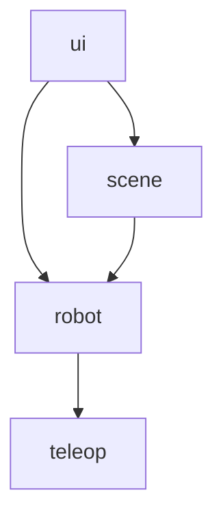
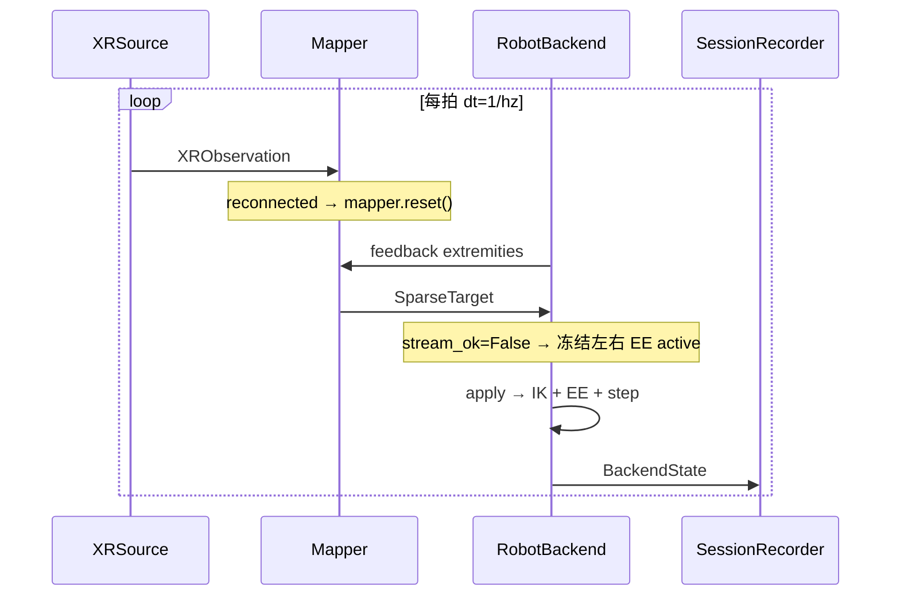
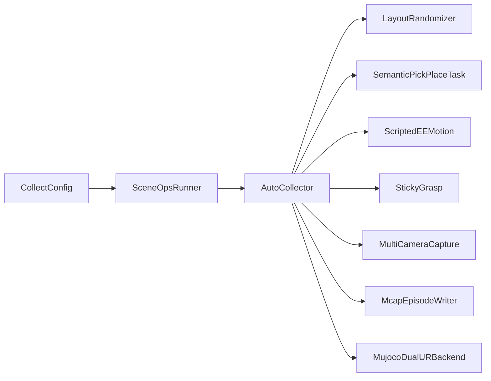

# teleop_birth 架构与算法流程总览

> 对应仓库现状（插件化场景 + robots registry + 双 UR / ArtiXon 双路径）  
> 偏「系统怎么拼起来、数据怎么流、算法落在哪」；学习向几何直觉见 [遥操作算法深入解析.md](./遥操作算法深入解析.md)；逐步公式与伪代码见 [遥操作全链路详解.md](./遥操作全链路详解.md)。

---

## 0. 一句话

**XR 只产出稀疏 SE(3) 目标（`SparseTarget`），机器人后端只消费该目标。**  
换机型 = 换 Mapper/Backend；换场景 = 换 plugins + scene 清单；主循环 `TeleopLoop` 不动。

```
Pico / Mock
  → XRSource → XRObservation
  → DualArmMapper（clutch / 世界系 Δ / LPF / 工作空间）
  → SparseTarget
  → RobotBackend.apply（IK + 夹爪 + mj_step / 真机）
  → BackendState（反馈给下一拍 Mapper）
```

两条已落地业务线共用同一总线：

| 路径 | Backend | 入口 |
|------|---------|------|
| 双 UR 桌面遥操 / 采数 | `MujocoDualURBackend` | `./start_pico_sim.sh`、场景工坊、`scene_ops` |
| 物流双 Arm-6A | `LogisticsTeleopBackend` | `./start_logistics_teleop.sh`、`scripts/robots/artixon_*` |

---

## 1. 四类软件架构

`src/teleop_birth/` 顶层只有四类，依赖方向：**ui → scene → robot → teleop**。



```
ui/       菜单、场景工坊
scene/    物品、布局、采集、MCAP、plugins/、assets/
robot/    registry、sim/、real/、ee/、io/、arm/wheeled/biped
teleop/   schema pipeline mapping control xr ik record config
```

### 1.1 机型注册表

入口：`teleop_birth.robot.list_robots()` / `load_backend(id)`。实现在 `robot/arm|wheeled|biped`。

| id | 类别 | 状态 |
|----|------|------|
| `ur5e` | arm | ready |
| `artixon_arm_6a` | arm | ready |
| `franka_panda` | arm | stub |
| `unitree_g1` | biped | stub |
| `galaxea_r1` | wheeled_humanoid | stub |

---

## 2. 核心数据协议

定义于 [`src/teleop_birth/teleop/schema/types.py`](../src/teleop_birth/teleop/schema/types.py)。

### 2.1 `XRObservation`（传感）

| 字段 | 含义 |
|------|------|
| `timestamp_ns` | XR 时间戳（延迟探针用） |
| `head` / `left_controller` / `right_controller` | 7D：`xyz + quat(xyzw)` |
| `body_joints` / `trackers` | 可选全身 / 脚踝 |
| `buttons` | Grip / Trigger / A·B·X·Y / Menu … |
| `valid` / `stream_ok` / `reconnected` | 有效帧、链路、重连沿 |

### 2.2 `SparseTarget`（控制总线）

| 字段 | 含义 |
|------|------|
| `extremities` | `left_ee` / `right_ee` / `head` /（人形）`pelvis` / `feet` → 7D 位姿 |
| `active` | 各 extremity 本拍是否推进 |
| `left_gripper` / `right_gripper` | 开合 0..1 |
| `meta` | 如 `home_left` / `home_right` 上升沿 |

**硬约束**：上层不把「关节角 retarget 结果」当总线；关节求解只在 Backend / IK 内部。

### 2.3 `BackendState`（反馈）

实现位姿、夹爪开度、`extra`（粘性抓取、TACTO、延迟等）。下一拍 `Mapper.map(obs, feedback)` 用反馈位姿做相对参考。

---

## 3. 遥操主循环算法

实现：[`teleop/pipeline/loop.py`](../src/teleop_birth/teleop/pipeline/loop.py) · `TeleopLoop`。



伪代码：

```text
source.start(); backend.connect(); mapper.reset()
while running:
  obs = source.read()
  if not obs.valid: sleep(dt); continue
  if obs.reconnected: mapper.reset()
  feedback = backend.get_feedback()
  target = mapper.map(obs, feedback)
  if not obs.stream_ok:
    target.active[left_ee/right_ee] = False   # 掉线冻结
  state = backend.apply(target)
  latency.tick(obs.timestamp_ns)
  recorder / on_step(...)
  sleep 对齐 hz
```

装配：

- **双 UR**：`run_teleop.py` + Hydra → [`teleop/config/factory.py`](../src/teleop_birth/teleop/config/factory.py) `build_teleop_loop`
- **物流**：[`scripts/robots/artixon_teleop.py`](../scripts/robots/artixon_teleop.py) 复用 `build_source` / `build_mapper`，Backend 换成 `LogisticsTeleopBackend`

---

## 4. 双臂映射算法（DualArmMapper）

实现：[`teleop/mapping/mappers.py`](../src/teleop_birth/teleop/mapping/mappers.py) + [`teleop/control/filters.py`](../src/teleop_birth/teleop/control/filters.py)。  
默认配置：`configs/algorithm/mapper/dual_arm.yaml`；一键 Pico 覆盖见 `configs/setup/xrobo.yaml`。

### 4.1 Clutch（相对锁定）

| `clutch_mode` | 行为 |
|---------------|------|
| `long_press_grip`（默认） | Grip ≥ `grip_threshold` 持续 `hold_s` 后接合；松开冻结 |
| `always` | 始终跟随 |
| `grip_or_trigger` | Grip 或 Trigger 可接合 |

接合瞬间锁定：

- \(\mathbf{p}_{\mathrm{XR}}^{(0)}, R_{\mathrm{XR}}^{(0)}\)（手柄参考）
- \(\mathbf{p}_{r0}, R_{r0}\)（机器人反馈参考）

### 4.2 世界系平移

\[
\Delta\mathbf{p}_{\mathrm{MJ}} = s\, R_a\,(\mathbf{p}_{\mathrm{XR}} - \mathbf{p}_{\mathrm{XR}}^{(0)})
,\quad
\mathbf{p}_t = \mathbf{p}_{r0} + \Delta\mathbf{p}_{\mathrm{MJ}}
\]

- \(s\)：`scale`（只缩放平移）
- \(R_a\)：`xr_align`，默认 `openxr_yup_to_zup`（OpenXR Y-up → MuJoCo Z-up）

### 4.3 姿态

房间竖直转左乘：\(R_{\mathrm{yaw}}=\mathrm{Rot}_z(\psi)\)，\(\psi\) 来自 \(R_a (R_x R_{x0}^{\top}) R_a^{\top}\) 绕 +Z 的转角。拧腕/侧倾用固定轴映射 \(M\) 右乘到夹爪体轴。合起来：

\[
R_t = R_{\mathrm{yaw}}\, R_{r0}\, \mathrm{Rot}(M\mathbf{w})
\]

`position_only: true` 时保持 \(R_{r0}\)，只跟位置。没有第二种姿态模式。

### 4.4 稳妥约束

1. **低通** `PoseLowPass`：`filter_alpha`（越大越跟手、越抖）
2. **限步** `_limit_step`：`max_step_m` / `max_step_rad`
3. **工作空间球** `_clamp_workspace`：中心 `workspace_center[left_ee|right_ee]`，半径 `workspace_radius_m`
4. **回零**：左 Y/Menu、右 B/Menu 上升沿 → clutch reset + `meta.home_*`
5. **夹爪**：\(\mathrm{openness} = \mathrm{trigger}^{\gamma}\)，`gripper_gamma` 默认约 0.55（仿真跟手）

### 4.5 HumanoidMapper（骨架）

同一 `SparseTarget` 协议扩展骨盆/双脚；当前以双臂为主路径，人形 Backend 多为 stub。

---

## 5. IK 与末端

### 5.1 共享 IK 工厂（双 UR 路径）

[`teleop/ik/__init__.py`](../src/teleop_birth/teleop/ik/__init__.py) · `build_arm_ik_solver(ik_cfg, model, data)`

| `ik.solver` | 实现 | 配置 | 说明 |
|-------------|------|------|------|
| `dls`（默认） | `ik/dls.py` | `configs/algorithm/ik/dls.yaml` | 雅可比阻尼最小二乘，无额外依赖 |
| `ssik` | `ik/ssik_solver.py` | `…/ssik.yaml` | UR5e 解析解；`--extra ik`；可 fallback dls |
| `curobo` | `ik/curobo_solver.py` | `…/curobo.yaml` | GPU；可 fallback dls |

Hydra：`ik=dls|ssik|curobo`。详见 [IK求解器切换.md](./IK求解器切换.md)。

`MujocoDualURBackend.apply`：对每个 `active` 臂求 IK → 写 actuator ctrl → `ParallelGripper` / `DexHandStub` → `mj_step`。

### 5.2 ArtiXon 本地 DLS

物流路径**不走**共享 `ik` 包，而用 [`robot/arm/artixon/ik_dls.py`](../src/teleop_birth/robot/arm/artixon/ik_dls.py)，参数来自 `configs/robots/artixon_teleop.yaml` 的 `ik:`。

---

## 6. 双 Backend 对照

### 6.1 双 UR MuJoCo

```
SparseTarget
  → MujocoDualURBackend
      → build_arm_ik_solver（共享）
      → ParallelGripper（2F-85）
      → robots.arm.ur5e.builder.build_dual_ur5e_2f85（menagerie）
      → mj_step (+ optional viewer)
```

- 配置：`configs/device/backend/mujoco_dual_ur.yaml`
- 场景资产：`third_party/mujoco_menagerie`

### 6.2 物流 ArtiXon（遥操）

```
SparseTarget
  → LogisticsTeleopBackend
      → DualArtixOnBackend（双 Arm-6A + 本地 DLS）
      → StickyGrasp（夹爪闭合 + 指垫靠近 → 粘性吸附）
      → AntiPenetrationManager（防穿模 / 支撑面）
      → MujocoTactoSensors（可选 DIGIT 视觉触觉）
      → PropPoseController
```

| 能力 | 模块 |
|------|------|
| 场景拼装 | `robots/arm/artixon/builder.py` |
| 粘性抓取 | `robots/arm/artixon/collection/sticky.py` |
| 防穿模 | `plugins/physics/anti_penetration.py` |
| TACTO | `plugins/sensor/tacto_bridge.py` + `third_party/tacto` |
| 遥操配置 | `configs/robots/artixon_teleop.yaml` |
| 场景几何 | `configs/robots/artixon_logistics_scene.yaml` |

**粘性抓取语义（遥操）**：夹爪开合 ≥ 阈值且指垫中心距物足够近 → 物体位姿钉到指缝中心；松开 → 释放并交防穿模处理。避免纯接触仿真难抓稳。

---

## 7. 场景工坊 · 插件 · 自动采集

### 7.1 插件契约

[`scene/plugins/base.py`](../src/teleop_birth/scene/plugins/base.py)：`Plugin` / `PluginContext`；资产类型在 [`scene/assets/types.py`](../src/teleop_birth/scene/assets/types.py)（`AssetRef` / `MountSpec`）。

| 插件 | 作用 |
|------|------|
| `scene` | 读 `configs/scenes/*.yaml`，`compose_scene` / `resolve_adapter` |
| `camera` | catalog 相机 + 视野 Tuner（select 回调注入，不依赖 cli） |
| `gripper` | catalog 夹爪 |
| `sensor` | DIGIT 等 |
| `physics` | 防穿模开关 |
| `collect` | 双 UR → `SceneOpsRunner`；物流 → `artixon_collect.py` |
| `arm_frame_map` | 手柄→臂房间系剖面（仿真/真机共用 `FrameMapPort`） |
| `xr_align` | 按语义映射生成 \(R_a\)（§5.2） |
| `wrist_orient` | 第 2 步姿态 \(R_t\)（§5.3） |
| `grip_to_tcp` | 握把→夹爪体轴 \(M\)（§5.4；`tip_down` / `tip_forward`） |
| `desktop_base` | 各 URDF base 落到桌面，换臂统一高度 |
| `frame_viz` | 共用界面：页签① \(R_a\) + ② \(R_t\) + ③ \(M\)（PyQt / 终端） |

核心实现：[`teleop/frame/`](../src/teleop_birth/teleop/frame/)；插件注册：[`scene/plugins/frame/`](../src/teleop_birth/scene/plugins/frame/)。

适配器（[`scene/plugins/scene/adapters.py`](../src/teleop_birth/scene/plugins/scene/adapters.py)）：

- `dual_ur5e` → `start_pico_sim.sh` + `scene_ops` 采集
- `logistics_x2arm` / `artixon` → `start_logistics_teleop.sh` + artixon 采集

### 7.2 双 UR 自动采集流水线



| 步骤 | 代码 | 配置 |
|------|------|------|
| 配置 | `scene_ops/config.py` `CollectConfig` | `configs/scene/cli.yaml` |
| 执行 | `scene_ops/runner.py` | — |
| 采集器 | `scene_ops/collection/auto_collector.py` | `recording.yaml` / tasks / props |
| 任务 | `scene_ops/tasks/pick_place.py` | `configs/scene/tasks/` |
| 物品 | `scene_ops/props/` | `configs/scene/props/` |

策略：随机布局 → 语义 pick/place stages → 粘性抓取对齐 → 多相机 JPEG → Foxglove 可读 MCAP。

### 7.3 物流自动采集

[`robot/arm/artixon/collection/collector.py`](../src/teleop_birth/robot/arm/artixon/collection/collector.py)  
策略：`policies/dual_sort.py` · `pick_flip_place`（入站取件 → 翻面 → 推出站）。  
配置：`configs/robots/artixon_collect.yaml` + `artixon_recording.yaml`。  
入口：`uv run python scripts/robots/artixon_collect.py [--no-render] [--episodes N]`。

---

## 8. 配置与启动入口

### 8.1 入口对照

| 入口 | 行为 |
|------|------|
| `./start.sh` | 交互菜单（工坊 / 一键遥操 / 采数 / 安装 XRobo …） |
| `./start_pico_sim.sh` | XRobo PC Service + Hydra 双 UR 遥操 |
| `./start_logistics_teleop.sh` | XRobo + `artixon_teleop.py`（非 Hydra 主配置） |
| `run_teleop.py` | `@hydra.main(configs/config.yaml)` |

示例：

```bash
uv run python run_teleop.py source=xrobo backend=mujoco_dual_ur ik=ssik
uv run python scripts/robots/artixon_collect.py --no-render --episodes 1
```

### 8.2 `configs/` 地图

```
configs/
  config.yaml                 # Hydra 默认：runtime / ik / mapper / source / backend / ee / paths
  algorithm/{runtime,mapper,ik}/
  device/{source,backend,end_effector,paths}/
  scene/{cli,recording,props,tasks}/   # 双 UR scene_ops（非遥操 Hydra 主链）
  scenes/                     # 工坊场景清单（dual_ur / logistics_x2arm）
  robots/                     # ArtiXon 遥操 / 采集 / 物流场景 YAML
  plugins/default.yaml
  setup/xrobo.yaml            # 一键 Pico 覆盖 + PC Service 路径
  ui/menu.yaml                # 终端菜单 handler
```

短覆盖：仓库内 `ik` / `mapper` / `source` / `backend` 等符号链接指向上述分组。

YAML 调参细节：[配置文件指南.md](./配置文件指南.md)。

---

## 9. 真机双端口（预留）

[`robot/io/`](../src/teleop_birth/robot/io/)：`StateReceiver` / `ActionPublisher` / `RobotEndpoint`。  
设计：仿真与真机都实现双端口，再经适配器接入 `TeleopLoop`；Mapper / XR / Loop **不改**。  
当前主路径仍直接使用 `RobotBackend`；详见 [模块与接口.md](./模块与接口.md)。

---

## 10. 端到端数据流（双 UR Pico）


物流路径：将 `MujocoDualURBackend` 换为 `LogisticsTeleopBackend`（本地 DLS + sticky + anti-pen + 可选 TACTO）；**Source / Mapper / Loop 不变**。

---

## 11. 文档导航

| 文档 | 内容 |
|------|------|
| **本文** | 当前架构分层 + 算法/采集全流程总览 |
| [架构与创新点_ProgressiveExtremityTeleop.md](./架构与创新点_ProgressiveExtremityTeleop.md) | PET 定位、论文叙事、路线图 |
| [遥操作全链路详解.md](./遥操作全链路详解.md) | 逐步公式、伪代码、参考仓库 |
| [遥操作算法深入解析.md](./遥操作算法深入解析.md) | SE(3)、失败模式、例题 |
| [IK求解器切换.md](./IK求解器切换.md) | DLS / SSIK / cuRobo |
| [配置文件指南.md](./配置文件指南.md) | YAML 怎么改 |
| [模块与接口.md](./模块与接口.md) | robot_io 双端口 |
| [Pico连接指南.md](./Pico连接指南.md) | 热点 / App / Send |
| [pico_teleop_方案调研与选型.md](./pico_teleop_方案调研与选型.md) | 竞品选型 |
