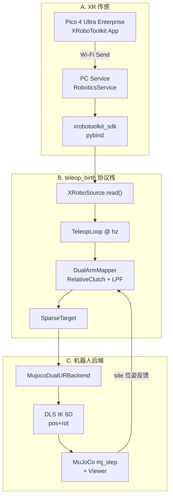
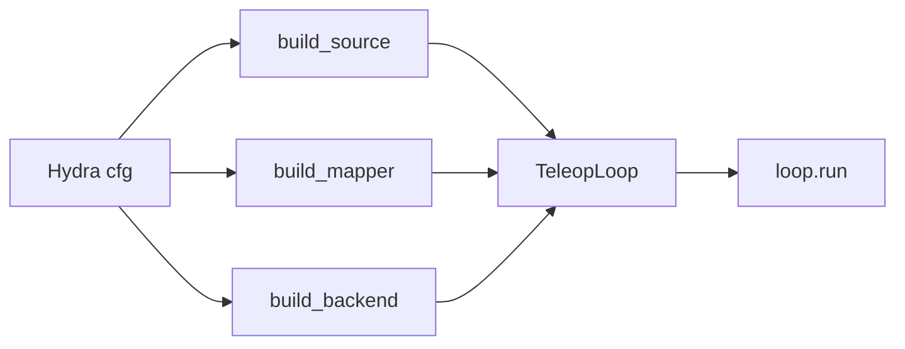
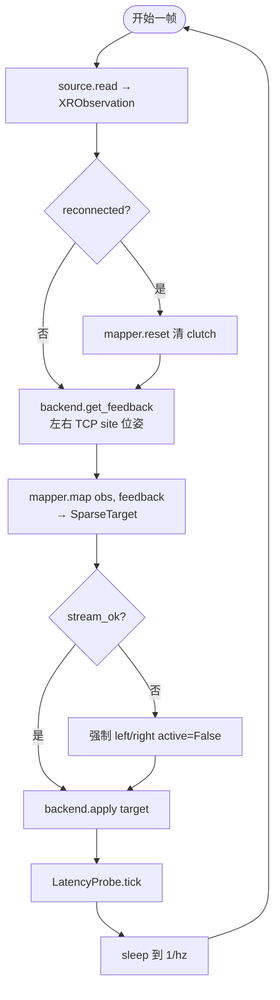
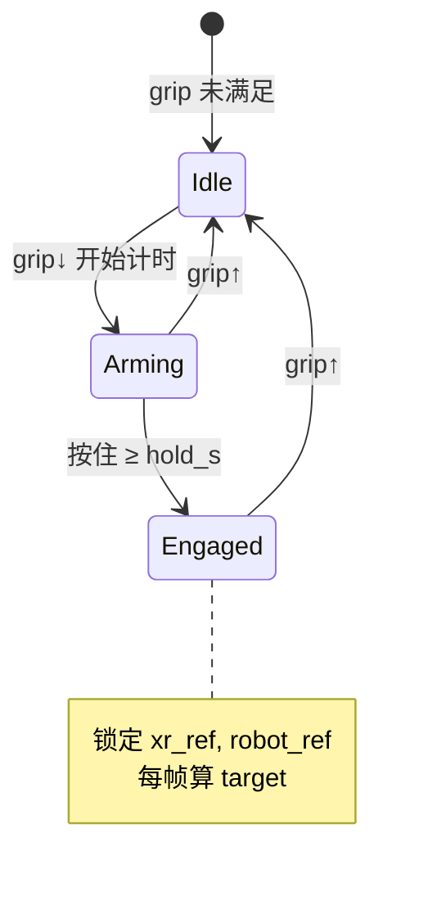
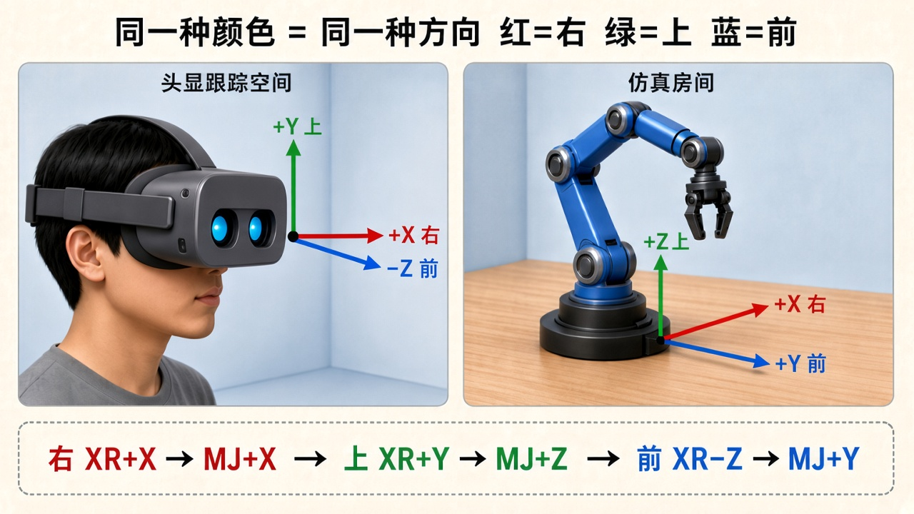
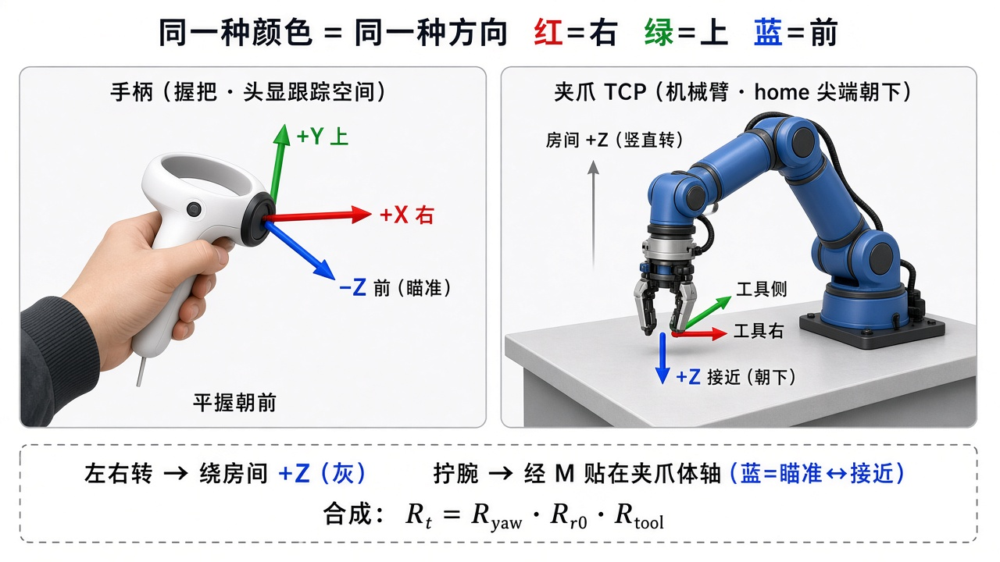
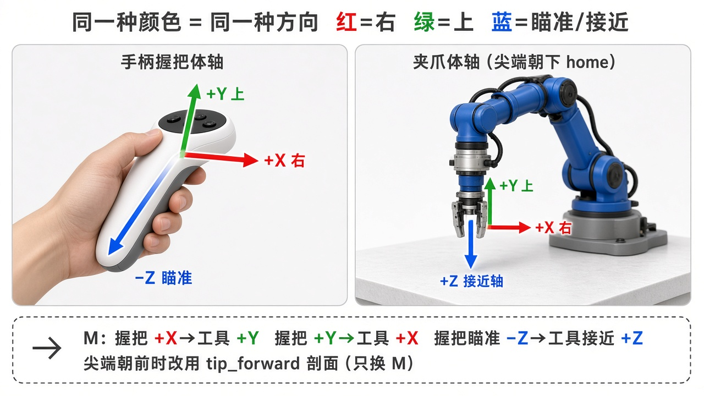
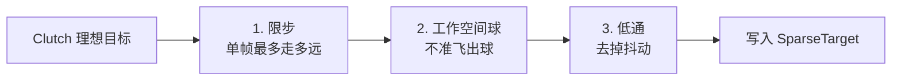
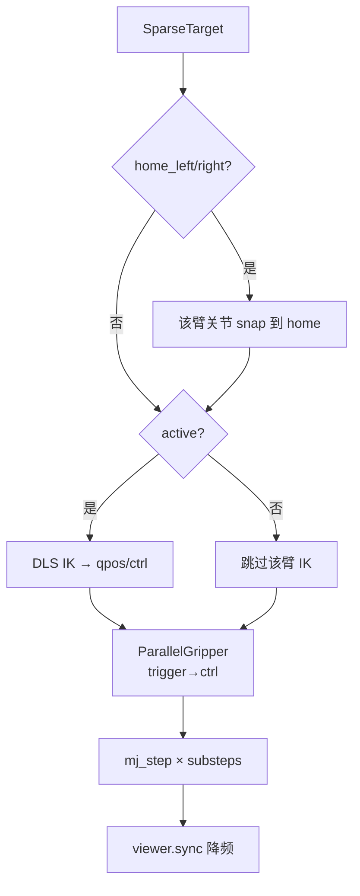
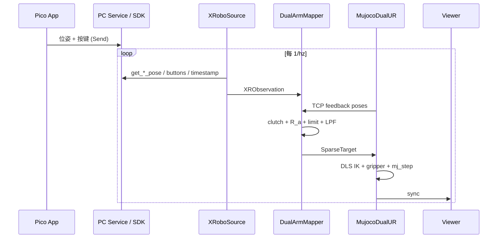

# Pico → MuJoCo 双臂遥操作：全链路详解

> 对应代码：`teleop_birth`（Progressive Extremity Teleop / PET）  
> 默认一键路径：`./start_pico_sim.sh`（约 **150 Hz**，世界系平移 + 腕部姿态，夹爪加速仿真）  
> **逐步对照代码（推荐）**：[Pico到机械臂逐步流程.md](./Pico到机械臂逐步流程.md)  
> **架构分层 + 全流程总览**：[架构与算法流程总览.md](./架构与算法流程总览.md)  
> **学习向深入解析（几何 / 失败模式 / 例题）**：[遥操作算法深入解析.md](./遥操作算法深入解析.md)  
> 操作上手：见 [Pico连接指南.md](./Pico连接指南.md)  
> 架构叙事 / 论文点：见 [架构与创新点_ProgressiveExtremityTeleop.md](./架构与创新点_ProgressiveExtremityTeleop.md)

本文说明**当前仓库实际在跑的**遥操作：从手柄位姿到 MuJoCo 关节指令，每一步做什么、用什么公式、对应哪段代码；并交代参考了哪些仓库、有哪些工程创新及效果。

---

## 0. 一句话流程

```
Pico 手柄位姿 (OpenXR)
  → XRoboToolkit PC Service / SDK
  → XRObservation
  → 长按 Grip：世界系平移 Δ + 腕部姿态（房间 yaw + 夹爪体轴拧腕）
  → SparseTarget（左右 EE SE(3) + Trigger^γ 夹爪）
  → 6D DLS IK + 加速后的 2F-85 物理步进
  → UR5e + Robotiq MuJoCo 仿真
  （物流路径只换 Backend：本地 DLS + hold 位姿 + sticky）
```

---

## 1. 系统总览（分层）



| 层 | 模块 | 输入 → 输出 | 配置入口 |
|----|------|-------------|----------|
| XR | `src/teleop_birth/teleop/xr/` | SDK → `XRObservation` | `configs/device/source/xrobo.yaml`, `configs/setup/xrobo.yaml` |
| 主循环 | `src/teleop_birth/teleop/pipeline/loop.py` | 定时 `read → map → apply` | `configs/config.yaml` → `runtime.hz` |
| 映射 | `teleop/mapping/` + `teleop/control/` | XR + 反馈 → `SparseTarget` | `configs/algorithm/mapper/dual_arm.yaml` |
| 双 UR 后端 | `robot/sim/mujoco_dual_ur.py` | `SparseTarget` → 关节/`ctrl` | `configs/device/backend/mujoco_dual_ur.yaml` |
| 双 UR 场景 | `robot/arm/ur5e/builder.py` | menagerie XML → `MjModel` | `paths.menagerie` |
| 物流后端 | `robot/arm/artixon/teleop_backend.py` | 同一 `SparseTarget` → Arm-6A | `configs/robots/artixon_teleop.yaml` |

**硬约定**：上层不把「某一套 IK 关节角」当成唯一接口；跨 embodiment 的主接口永远是 **`SparseTarget`**（稀疏末端目标）。

---

## 2. 启动与装配（一步步）

### 2.1 入口

| 入口 | 行为 |
|------|------|
| `./start_pico_sim.sh` | 拉 menagerie / 装 XRobo（若缺）→ 起 PC Service → 打印 IP → `run_teleop.py` + 一键 overrides |
| `./start.sh` | 交互菜单；可选「一键 Pico 仿真」 |
| `uv run python run_teleop.py ...` | Hydra 非交互组装 |

一键 overrides 见 `configs/setup/xrobo.yaml` → `one_click_pico_sim.overrides`（摘要）：

- `source=xrobo`, `backend=mujoco_dual_ur`, `mapper=dual_arm`
- `runtime.scale=2.0`（只放大位移；控制频率不在一键 overrides 里，只看 `algorithm/runtime/default.yaml` 的 `hz`）
- `mapper.xr_align=openxr_yup_to_zup`
- `mapper.position_only=false`
- `mapper.max_step_m=0.20`, `mapper.max_step_rad=0.35`, `mapper.workspace_radius_m=1.30`
- `mapper.gripper_gamma=0.55`
- `ik=dls`, `ik.position_only=false`, `ik.rot_weight=0.30`, `ik.ori_err_cap=0.25`, `ik.iters=20`, `ik.max_dq=0.28`
- `backend.sim_substeps=4`；`end_effector.force_scale=16`, `extra_sim_steps=6`

### 2.2 Factory 装配顺序



伪代码（对应 `src/teleop_birth/teleop/config/factory.py` + `run_teleop.py`）：

```text
cfg ← Hydra.load("configs/config.yaml") ⊕ CLI/overrides
source  ← XRoboSource(api_names from setup/xrobo.yaml)   # 或 MockXRSource
mapper  ← DualArmMapper(mapper.yaml, scale=runtime.scale)
backend ← MujocoDualURBackend(menagerie, scene, ik, ee)
loop    ← TeleopLoop(source, mapper, backend, hz=runtime.hz)
loop.run(duration_s)   # 0 = 直到 Ctrl+C
```

---

## 3. 主循环（每帧发生什么）

对应 `TeleopLoop.run`（`src/teleop_birth/teleop/pipeline/loop.py`）。



伪代码：

```text
source.start(); backend.connect(); mapper.reset()
while running:
    t0 ← now()
    obs ← source.read()
    if obs.reconnected: mapper.reset()          # 避免旧参考猛拉
    feedback ← backend.get_feedback()           # Dict[name → pose₇]
    target ← mapper.map(obs, feedback)
    if not obs.stream_ok:
        target.active[left_ee] = target.active[right_ee] = False
    state ← backend.apply(target)
    # plot.enabled 时：read 后画 Pico 原始 xyz；ik.solve 前画目标 xyz
    latency.tick(obs.timestamp_ns)
    sleep(max(0, 1/hz − (now()−t0)))
```

**时序目标**：Pico 一键默认 \(f = 150\,\mathrm{Hz}\)，周期 \(\Delta t \approx 6.7\,\mathrm{ms}\)。

配置：\(f=\) `runtime.hz`，只写在 `configs/algorithm/runtime/default.yaml`（`150`）。一键 overrides **不改**它。`duration_s=0` 在 `configs/setup/xrobo.yaml`，表示一直跑到 Ctrl+C。

#### Pico ≈100 Hz 发、控制环 150 Hz：怎么对上的？

这是**两套时钟**，不要当成「把 Pico 插值成 150 Hz」。

| 时钟 | 典型频率 | 谁决定 | 代码 |
|------|----------|--------|------|
| **Pico / OpenXR 流** | 约 **90–100 Hz**（头显刷新与 Send 节奏，SDK 不保证刚好 100） | 头显 + XRoboToolkit + PC Service | `get_*_controller_pose()` / `get_time_stamp_ns()` |
| **本机控制环** | **150 Hz**（可改） | `runtime.hz` | `TeleopLoop.run`：每拍 `read → map → apply → sleep` |

**做法：轮询 + 零阶保持（ZOH），不做 XR 位姿上采样。**

1. 控制环按 \(1/150\,\mathrm{s}\) 醒来，调用 `XRoboSource.read()`。
2. `read()` **不阻塞等新帧**：直接读 SDK **全局缓冲里最新的一份** 7 维 pose + 时间戳。
3. Pico 若还在 ~100 Hz 更新，则大约每 **1.5 个控制拍** 才会换一份新样本；中间那几拍读到的是**同一时间戳、同一 xyz/四元数**（重复读缓冲）。
4. 相对 clutch 看的是「相对按下瞬间的差」。位姿没变 ⇒ \(\Delta\mathbf{p}=0\)、相对旋转为 \(I\) ⇒ 本拍理想目标与上一拍相同（低通会再朝同一目标靠一点，很快贴住）。
5. **没有**「在两帧 Pico 之间线性插值手柄」这类上采样；150 Hz 多出来的拍，是 PC 侧自己在跑 IK / `mj_step` / 限步 / 滤波 / 夹爪。

示意图：

```text
时间 →
Pico 样本:  ●─────●─────●─────●─────●     (~100 Hz 更新缓冲)
控制环拍:   ↑ ↑ ↑ ↑ ↑ ↑ ↑ ↑ ↑ ↑ ↑ ↑ ↑ ↑   (150 Hz 轮询)
            │ │ │ │ │ │ │ │ │ │ │ │ │ │
            同一缓冲可能被连续读 1～2 拍
```

**为什么还要 150 Hz（而不是把环也降到 100）？**

| 仍按 150 Hz 跑的部分 | 作用 |
|----------------------|------|
| `backend.apply` / DLS / `mj_step` | 仿真与求解更密，臂在两次 Pico 更新之间也能小步追目标 |
| Mapper 限步 / 工作空间球 / 低通 | 按**控制拍**计（`max_step_m` 是「每拍最多走多远」）；环越快，同样数值对应的墙钟速度上限越高 |
| Trigger 夹爪 | 与 clutch 无关，每拍都能更新开合 |
| `LatencyProbe` / 轨迹图 | 图上 `set 150 Hz` = 控制环设定；`recv ~xx Hz` = 滑动窗口里 **时间戳真正变化** 的 Pico 接收率（见 `plot.rate_window_s`） |

**和「掉线」怎么区分？**

- 时间戳 **短时间不变**（例如连续 1～2 拍）：正常，多半是 Pico 还没推新帧，继续用旧缓冲。
- 时间戳 **连续 ≥ `stale_s`（默认 5 s）不变**：才判 `stream_ok=false`，主循环冻结左右 EE（§4.3）。手静止但时间戳仍在走 ⇒ **不算**掉线。

人话：**Pico 大约每秒塞进缓冲 100 次新手势；PC 每秒醒 150 次去摸缓冲。** 摸到新的就跟新手势算差；摸到旧的就当「手没动」再解一拍 IK。不是把 100 Hz「拉伸」成 150 Hz 的假动作。

**延迟探针**（同帧）：

\[
t_{\mathrm{xr\to cmd}} = \max\bigl(0,\; t_{\mathrm{now}}^{\mathrm{ns}} - t_{\mathrm{obs}}^{\mathrm{ns}}\bigr) / 10^{6}
\quad[\mathrm{ms}]
\]

配置：这个差没有倍率可调。滑动窗口长度是 `runtime.latency_window`（默认 `300` 帧，同一份 runtime YAML）。环路耗时 \(t_{\mathrm{loop}}\) 只统计，不进控制。

---

## 4. XR 观测：从 Pico 到 `XRObservation`

### 4.1 物理链路

1. 头显 **XRoboToolkit** 打开 **WORKING + Send**  
2. 局域网发往本机 **PC Service**（`RoboticsService`）  
3. Python **`xrobotoolkit_sdk`**（本仓库编译的 pybind）读全局缓冲  
4. `XRoboSource.read()` 打成统一 schema

### 4.2 位姿约定

每路 6DoF 存成 **7 维向量**（`POSE_DIM = 7`）：

\[
\mathbf{x} = \bigl[\,p_x,\, p_y,\, p_z,\; q_x,\, q_y,\, q_z,\, q_w\,\bigr]^\top
\in \mathbb{R}^{7}
\]

齐次变换：

\[
T(\mathbf{x}) =
\begin{bmatrix}
R(\mathbf{q}) & \mathbf{p} \\
\mathbf{0}^\top & 1
\end{bmatrix}
\in SE(3)
\]

OpenXR 世界系（头显跟踪空间，**Y‑up，−Z 前**）与 MuJoCo 场景（**Z‑up，+Y 朝桌子深处**）不一致，因此映射层必须做轴对齐（§5.2）。目标朝向 \(R_t\) 见 §5.3；握把→夹爪体轴 \(M\) 见 §5.4。三套坐标系怎么连、为什么头显位姿不驱动手臂，见 §5.8。

### 4.3 按钮 / 夹爪语义（当前默认）

| 输入 | 作用 |
|------|------|
| **Grip** 长按 ≥ `hold_s` | 该侧 clutch **接合**，开始相对遥操（clutch 释义见 **§5.0**） |
| 松开 Grip | **断开**，末端保持上一目标 |
| **Trigger** | 该侧夹爪开合 \(g\in[0,1]\)（与 clutch 无关，每帧更新） |
| 左手 **Y / Menu** 上升沿 | 左臂回 home + 清 clutch |
| 右手 **B / Menu** 上升沿 | 右臂回 home + 清 clutch |

掉线只看 SDK **时间戳是否停滞**，不用位姿是否移动（手静止不算掉线）。时间戳连续 `stale_s`（默认 5 s）不变 → `stream_ok=false`，主循环冻结左右 EE 的 `active`。自动重连默认 **关**（`reconnect.enabled: false`）。

---

## 5. 映射核心：相对 clutch + 世界系轴对齐

实现：`RelativeClutch`（`teleop/control/filters.py`）+ `WristOrientationMap`（`teleop/frame/orientation.py`）+ `DualArmMapper.map`。

### 5.0 clutch 是什么？

**clutch** 本意是机械里的**离合器**：踩下才把动力接上，松开就断开，从动端停在断开那一刻的位置，不会弹回。

本仓库借用这个词，指遥操里的 **「按住才跟手 / 松开就冻结」开关**（代码类名 `RelativeClutch`）：

| 类比 | 车上的离合器 | 本仓库的 clutch |
|------|--------------|-----------------|
| 接合 | 动力传到轮子 | **长按 Grip** ≥ `hold_s` → 该侧开始跟手柄 |
| 断开 | 动力断开，车靠惯性/刹车停 | **松开 Grip** → 该侧不再跟新手势，目标停在最后一次有效指令 |
| 作用 | 避免一挂挡就猛窜 | 避免「手柄一进视野，夹爪瞬移到绝对 XR 坐标」 |

所以文档里说的「接合 / 断开 / 清 clutch」，都是在说这套开关的状态，不是汽车零件。

#### 它管什么、不管什么

| 管 | 不管 |
|----|------|
| **要不要**跟手（`engaged` / Mapper 的 `active`） | 夹爪开合（那是 **Trigger**，每拍都算） |
| 接合瞬间锁两份参考：`xr_ref`、`robot_ref` | 限步 / 工作空间球 / 低通（那是 Mapper 后处理，§5.6） |
| 接合后按**相对增量**算理想目标 \(\mathbf{x}_t\) | IK、仿真步进（Backend） |

左右手 **各有一套** clutch，互不影响；左手 Y/Menu、右手 B/Menu 回零时会 `clutch.reset` 清掉该侧参考。

#### 三种状态（人话）

```text
未按 Grip / 没按够 hold_s
    → Idle：不算相对目标；臂停在 last（或根本不调 IK）

长按满 hold_s 的上升沿
    → 刚接合：拍快照 xr_ref、robot_ref（两份 7 维）
    → 之后 Engaged：每拍用「现在 − 参考」算理想 TCP

松开 Grip
    → 回到 Idle：丢掉参考；臂停在松开前最后一次滤完的目标（不弹 home）
```

一键默认：`clutch_mode=long_press_grip`，`grip_threshold=0.45`，`hold_s=0.2`（须连续按住约 0.2 s 才接合，防误触）。

#### 为什么叫「相对」clutch？

接合时记下：

- \(\mathbf{x}_{\mathrm{xr}}^{(0)}\)：那一瞬间**手柄**在头显跟踪空间的位姿  
- \(\mathbf{x}_{\mathrm{r}}^{(0)}\)：那一瞬间**夹爪 TCP** 在房间系的位姿  

之后只回答：「相对按下那一下，手又挪了多少、又拧了多少？」——把增量加到 \(\mathbf{x}_{\mathrm{r}}^{(0)}\) 上，得到理想目标。  
**不对齐**头显原点与机器人原点，所以接合瞬间目标 = 当时 TCP，臂不会瞬移。这就是 §5.1 相对模式的全部动机。

和后面名词的关系：

- clutch **里面**算平移（§5.5）和姿态 \(R_t\)（§5.3，经 \(R_a\)、\(M\)）；  
- clutch **算完**的理想 7 维，才交给限步 / 球 / 低通（§5.6）。

### 5.1 为什么用「相对」而不是「绝对」

绝对映射会把 XR 世界原点直接当成机器人世界原点 → 接合瞬间末端**瞬移**。  
相对遥操（相对 clutch）：接合瞬间锁定 \((\mathbf{x}_{\mathrm{xr}}^{(0)},\, \mathbf{x}_{\mathrm{r}}^{(0)})\)，之后只跟**增量**。



伪代码（单臂）：

```text
function clutch_update(name, grip, xr_now, robot_now, scale):
    if not want_engage(grip):
        clear refs; return (False, None)
    if rising_edge to engaged:
        xr_ref ← xr_now
        robot_ref ← robot_now
    target ← map(xr_now, refs, scale)
    return (True, target)
```

### 5.2 OpenXR(头显坐标系) → MuJoCo 轴对齐矩阵 \(R_a\)

左右两张图都是标准右手坐标系：同一个原点、三根互相垂直的箭头，标法一样。左边头显是 \(+X\) 右、\(+Y\) 上、\(−Z\) 前；右边房间是 \(+X\) 右、\(+Y\) 前、\(+Z\) 上。头显脸朝的方向标成 \(−Z\)。\(R_a\) 只是把轴的名字对上，两个原点从不叠在一起。右边标的是房间世界系，不是夹爪自己的体轴（夹爪停着时朝下，朝下不是房间的「上」）。



默认预设 `openxr_yup_to_zup`：

\[
R_a =
\begin{bmatrix}
1 & 0 & 0 \\
0 & 0 & -1 \\
0 & 1 & 0
\end{bmatrix}
\quad\Rightarrow\quad
\mathbf{v}_{\mathrm{MJ}} = R_a\,\mathbf{v}_{\mathrm{XR}}
\]

配置：\(R_a\) 来自 `mapper.xr_align`（或 `mapper.arm_profile` / `mapper.xr_mapping`）。默认和一键都是 `openxr_yup_to_zup`，写在 `configs/algorithm/mapper/dual_arm.yaml`，一键在 `configs/setup/xrobo.yaml` 再写一遍。要换轴就改 `mapper.xr_align_matrix`（3×3，设了就不用预设名），或用插件按语义生成：

```python
from teleop_birth.scene.plugins.frame import XrAlignPlugin
R_a = XrAlignPlugin().build(xr_right_to="+x", xr_up_to="+z", xr_forward_to="+y")
```

臂剖面（仿真/真机共用）：`configs/plugins/frame/arm_profiles.yaml`，Mapper 里填 `arm_profile: mujoco_table_zup`。  
交互式终端：`./start.sh` → **「坐标系插件」**（或场景工坊内同名项）— 终端生成 \(R_a\)、查看剖面、算桌面 mount、可选 PyQt。  
自定义遥操配置里也可选 `arm_profile`。  
`identity` 等于不换轴，只用来消融。

| XR 方向 | 向量 | 乘 \(R_a\) 之后 | 映射后 MuJoCo |
|---------|------|----------------|----------------|
| +X（右） | \((1,0,0)\) | 第 1 列 \((1,0,0)\) | +X |
| +Y（上） | \((0,1,0)\) | 第 2 列 \((0,0,1)\) | +Z |
| −Z（前） | \((0,0,-1)\) | 第 3 列 \(=(0,1,0)\) | +Y（朝桌子） |

矩阵乘向量时，结果是「三列分别乘以向量的三个分量再相加」。所以第 1 列就是 XR 的 +X 被送到哪里，第 2 列是 +Y，第 3 列是 +Z。这个矩阵不是随便写的：头显里的「右 / 上 / 前」必须变成房间里的「右 / 上 / 前」。

向右，XR 的 \((1,0,0)\)：

\[
R_a\begin{bmatrix}1\\0\\0\end{bmatrix}
=
\begin{bmatrix}1\\0\\0\end{bmatrix}
\]

还是房间的 +X。两边都把「右」叫 X，不用换。

向上，XR 的 \((0,1,0)\)。头显里的「上」是 Y，房间里的「上」是 Z：

\[
R_a\begin{bmatrix}0\\1\\0\end{bmatrix}
=
\begin{bmatrix}0\\0\\1\end{bmatrix}
\]

第 2 列 \((0,0,1)\) 就是在做这件事。

向前。OpenXR 里人看向 **−Z**，所以「前」不是 \((0,0,1)\)，而是 \((0,0,-1)\)。第 3 列是 \((0,-1,0)\)，它把 XR 的 +Z 送到房间的 −Y；向前再取一次负：

\[
R_a\begin{bmatrix}0\\0\\-1\end{bmatrix}
=
-\begin{bmatrix}0\\-1\\0\end{bmatrix}
=
\begin{bmatrix}0\\1\\0\end{bmatrix}
\]

仿真里桌子往 +Y 深处摆，所以「往前推手柄」变成「夹爪朝桌子走」。反过来核对：房间的上 \((0,0,1)\) 变回去必须是头显的上；房间的前 \((0,1,0)\) 变回去必须是头显的前 \((0,0,-1)\)。这个矩阵满足这两条。

\(R_a\) **只换轴名，不平移原点**。头显跟踪空间的 (0,0,0) 不会被搬到机器人的 (0,0,0)。

可在 YAML 用 `xr_align_matrix` 覆盖；或设 `xr_align: identity` 做消融（这时前/上对不上，只适合调试）。

\(R_a\) 只负责**轴名**；下一节的目标旋转 \(R_t\) 才负责「手怎么拧，腕怎么跟」。可选的 `controller_quat_xyzw`（\(R_{\mathrm{ctrl}}\)）在姿态节使用，不改变平移，也不改变 \(R_a\)。

### 5.3 手柄相对旋转 → 目标 TCP 旋转 \(R_t\)

与上一节的 \(R_a\) **同级**：\(R_a\) 只换轴名；\(R_t\) 才是「这一帧夹爪该朝哪」。  
平移 \(\mathbf{p}_t\) 和姿态 \(R_t\) **分开算**，再在 clutch 流水线里合成 7 维目标（见 §5.5）。

读法和 §5.2 一样：同色＝同语义（红=右、绿=上、蓝=前/瞄准·接近）。左边是**平握手柄**（头显跟踪空间里的握把体轴：\(+X\) 右、\(+Y\) 上、\(-Z\) 瞄准）；右边是**机械臂夹爪 TCP**（home 尖端朝下：蓝轴为接近轴朝下），灰色是房间 \(+Z\)（竖直转 \(\psi\)）。姿态拆两路：左右转跟房间竖直轴；拧腕经 \(M\) 贴在夹爪体轴上，再合成 \(R_t=R_{\mathrm{yaw}} R_{\mathrm{r}0} R_{\mathrm{tool}}\)。



代码：`WristOrientationMap`（`teleop/frame/orientation.py`）← `RelativeClutch._map` / 插件 `wrist_orient`。  
\(M\) 由插件 `grip_to_tcp` 提供（§5.4）。  
交互对照：终端「坐标系插件 → 腕部姿态分步演示」或 PyQt 共用界面**页签②**（①=\(R_a\)，③=\(M\)）。

#### 为什么不能「整段旋转原样扣上去」？

夹爪 home 时**朝下**（接近轴 ≈ 房间 −Z），手柄通常**平着朝前**。若把手柄在房间里的整段旋转直接左乘到 TCP 上，你一拧腕，夹爪的「朝下」会被掀开——手感会怪。  
所以拆成两件事：

| 你的手在干什么 | 臂怎么跟 | 符号 |
|----------------|----------|------|
| 左右转（绕竖直） | 绕**房间** +Z 转 | \(\psi,\ R_{\mathrm{yaw}}\) |
| 拧腕、侧倾 | 贴在**夹爪自己的轴**上转 | \(\mathbf{w},\ M,\ R_{\mathrm{tool}}\) |

人话：**左右转跟天花板；拧腕贴在夹爪自己身上。**

#### 本节符号（与全文统一）

| 符号 | 含义 | 从哪来 |
|------|------|--------|
| \(R_{\mathrm{xr}}^{(0)},\ R_{\mathrm{xr}}\) | 按下时 / 现在的手柄朝向（头显跟踪空间）；**由 SDK 四元数转成的矩阵** | 7 维 pose 经 `pose_to_matrix` |
| \(R_{\mathrm{ctrl}}\) | 手柄本地**固定**轴修正（可选贴纸）；默认不做；YAML 里也是四元数 | `mapper.controller_quat_xyzw` → 矩阵；省略 = \(I\) |
| \(R_{x0}=R_{\mathrm{xr}}^{(0)}R_{\mathrm{ctrl}}\) | 按下时、修正后的手柄旋转（矩阵） | 上两行相乘 |
| \(R_{x1}=R_{\mathrm{xr}}R_{\mathrm{ctrl}}\) | 现在、修正后的手柄旋转（矩阵） | 同上 |
| \(R_a\) | 头显轴→房间轴（矩阵） | §5.2 / `arm_profile` |
| \(R_{\mathrm{r}0}\) | **按下 Grip、接合瞬间**夹爪 TCP 在**房间系**的朝向（姿态锚）；**由 TCP 四元数转成的矩阵** | clutch `robot_ref` ← `get_feedback()`，再 `pose_to_matrix` |
| \(R_{\Delta}^{\mathrm{MJ}}\) | 手柄相对旋转改到房间系（矩阵） | 见下 ② |
| \(\psi,\ R_{\mathrm{yaw}}\) | 房间竖直转角与矩阵 | 见下 ③ |
| \(\mathbf{w},\ M,\ R_{\mathrm{tool}}\) | 体轴增量、握把→TCP、拧腕矩阵 | ④；\(M\) 见 **§5.4**；⑤ |
| \(R_t\) | 本帧目标 TCP 朝向（**矩阵**；出 clutch 前再转回四元数） | 见下 ⑥ |

#### 表示法：线缆上是四元数，算姿态时是矩阵

全链路位姿总线是 7 维（代码 `POSE_DIM=7`）：

\[
\mathbf{x}=[p_x,p_y,p_z,q_x,q_y,q_z,q_w]^\top
\]

- **手柄**：OpenXR / Pico SDK 报的就是这套（xyz + **四元数 xyzw**），不是旋转矩阵。
- **TCP 反馈**：`get_feedback()` 也写成同一套 7 维（仿真里从 site 的 `xmat` 转成四元数再发出）。
- **姿态公式**（①–⑥）习惯用 \(3\times3\) 矩阵相乘，所以进出都要换一次表示法：

| 函数 | 方向 | 何时用 |
|------|------|--------|
| `pose_to_matrix(\(\mathbf{x}\))` | 7 维 → \(4\times4\)（左上是 \(R(\mathbf{q})\)） | 算相对旋转 / 取 \(R_{\mathrm{r}0}\) 之前 |
| `matrix_to_pose(T)` | \(4\times4\) → 7 维（\(R\) → 四元数） | 得到 \(R_t\) 之后，交给 Mapper |

**朝向没变，只换写法。** 四元数方便存和插值；矩阵方便乘、取 yaw、取轴角。下面 ①–⑥ 里凡写 \(R_{\cdots}\) 的，都已是矩阵。

下面按「按下 Grip 之后的某一帧」往下走。令按下瞬间为「0」，现在为「1」。  
六步一张图（先看懂流程，再往下读每一节）：

| 步 | 输入 → 输出 | 人话 | 表示 |
|----|-------------|------|------|
| ⓪ | 7 维 pose → \(R_{\mathrm{xr}}^{(0)},R_{\mathrm{xr}},R_{\mathrm{r}0}\) | SDK / 反馈的四元数先变成矩阵 | `pose_to_matrix` |
| ① | \(R_{\mathrm{xr}}\xrightarrow{R_{\mathrm{ctrl}}}R_{x0},R_{x1}\) | 可选：把握把轴贴到你心里的瞄准轴 | 矩阵×矩阵 |
| ② | \(R_{x0},R_{x1},R_a\to R_{\Delta}^{\mathrm{MJ}}\) | 相对转了多少，并换到房间轴习惯 | 矩阵 |
| ③ | \(R_{\Delta}^{\mathrm{MJ}}\to\psi,R_{\mathrm{yaw}}\) | 只留下绕天花板转的那一段 | 标量 + 矩阵 |
| ④ | \(R_{x0},R_{x1}\to\mathbf{w}\)（清零 \(w_y\)） | 手柄自己身上还拧了多少；竖直不重复算 | 轴角向量 |
| ⑤ | \(\mathbf{w},M\to R_{\mathrm{tool}}\) | 把手柄拧法贴到夹爪（详解 **§5.4**） | 轴角→矩阵（`rot_from_aa`） |
| ⑥ | \(R_{\mathrm{yaw}},R_{\mathrm{r}0},R_{\mathrm{tool}}\to R_t\) | 转盘 × 按下朝向 × 拧螺丝 | 矩阵；出节后再→四元数 |

#### ⓪ 先把四元数变成矩阵（不要省）

接合时 clutch 锁了两份 **7 维**：

\[
\mathbf{x}_{\mathrm{xr}}^{(0)}
=
[\mathbf{p}_{\mathrm{xr}}^{(0)},\ \mathbf{q}_{\mathrm{xr}}^{(0)}]
,\qquad
\mathbf{x}_{\mathrm{r}}^{(0)}
=
[\mathbf{p}_{\mathrm{r}}^{(0)},\ \mathbf{q}_{\mathrm{r}}^{(0)}]
\]

本帧手柄也是 7 维 \(\mathbf{x}_{\mathrm{xr}}=[\mathbf{p}_{\mathrm{xr}},\mathbf{q}_{\mathrm{xr}}]\)。

代码（`WristOrientationMap.map_from_poses`）第一步：

\[
\begin{aligned}
R_{\mathrm{xr}}^{(0)} &= R(\mathbf{q}_{\mathrm{xr}}^{(0)})
&&\leftarrow\texttt{pose\_to\_matrix}(\mathbf{x}_{\mathrm{xr}}^{(0)})[:3,:3]\\
R_{\mathrm{xr}} &= R(\mathbf{q}_{\mathrm{xr}})
&&\leftarrow\texttt{pose\_to\_matrix}(\mathbf{x}_{\mathrm{xr}})[:3,:3]\\
R_{\mathrm{r}0} &= R(\mathbf{q}_{\mathrm{r}}^{(0)})
&&\leftarrow\texttt{pose\_to\_matrix}(\mathbf{x}_{\mathrm{r}}^{(0)})[:3,:3]
\end{aligned}
\]

其中 \(R(\mathbf{q})\) 是「四元数 → 旋转矩阵」的标准公式（实现就在 `pose_to_matrix` 里）。  
可选的 \(R_{\mathrm{ctrl}}\) 若配置了，YAML 里也是四元数 `controller_quat_xyzw`，进内存时同样先转成矩阵（`quat_xyzw_to_R`）。

之后 ①–⑥ **只拿这些矩阵算**，直到 §5.5 第 3 步再把 \(R_t\) 转回四元数。

#### ① 先把手柄朝向 乘 可选修正 \(R_{\mathrm{ctrl}}\)（默认不做）

\[
R_{x0}=R_{\mathrm{xr}}^{(0)}\,R_{\mathrm{ctrl}}
,\qquad
R_{x1}=R_{\mathrm{xr}}\,R_{\mathrm{ctrl}}
\]

##### \(R_{\mathrm{ctrl}}\) 是什么？

OpenXR / Pico SDK 报上来的手柄朝向 \(R_{\mathrm{xr}}\)，对应的是手柄上**某一个固定的坐标系**（常叫 grip / 握把系）：哪根轴叫「右、上、瞄准」由 SDK 规定，不一定等于你握着时心里想的「射线往哪指」。

\(R_{\mathrm{ctrl}}\) 就是贴在**手柄自己身上**的一块「固定转角贴纸」：

- **固定**：每一帧都是同一个矩阵，不会跟着你挥手变。
- **本地**：乘在手柄右侧（\(R_{\mathrm{xr}}R_{\mathrm{ctrl}}\)），表示「先按贴纸把握把轴拧一下，再放到跟踪空间里」。
- **可选**：YAML 里不写 `mapper.controller_quat_xyzw` 时，\(R_{\mathrm{ctrl}}=I\)（单位阵）= **完全不做**。一键默认就是不做。

人话：SDK 说「这根轴叫瞄准」；你握着觉得「真正瞄准的是偏了 15° 的那根」。\(R_{\mathrm{ctrl}}\) 就是把这两根轴对上的那 15°。对上之后，后面的「拧腕 / 侧倾」才会绕你以为在拧的那根轴转。

##### 它改什么、不改什么

| 项目 | 有没有 \(R_{\mathrm{ctrl}}\) |
|------|------------------------------|
| 平移 \(\mathbf{p}_t\)（手挪位置） | **不改**。位移只用位置差 × \(R_a\) × \(s\) |
| 轴对齐 \(R_a\)（头显右/上/前 ↔ 房间） | **不改**。那是 §5.2 |
| 握把→夹爪的固定轴映射 \(M\) | **不改**。\(M\) 写死在代码里 |
| 姿态里「绕哪根手柄轴算拧腕」 | **会改**。先用贴纸重标手柄体轴，再算 \(\mathbf{w}\)、再乘 \(M\) |

所以：**平移怪 → 先查 \(R_a\)；拧腕轴对不上握把 → 再考虑 \(R_{\mathrm{ctrl}}\)；不要为了拧腕去改 \(M\)。**

##### 为什么多数时候可以不管它？

相对遥操看的是「相对按下那一瞬间拧了多少」。若 \(R_{\mathrm{ctrl}}\) 恒定，房间竖直转用的

\[
R_{x1}R_{x0}^{\top}
=
(R_{\mathrm{xr}}R_{\mathrm{ctrl}})(R_{\mathrm{xr}}^{(0)}R_{\mathrm{ctrl}})^{\top}
=
R_{\mathrm{xr}}R_{\mathrm{xr}}^{(0)\top}
\]

里 **\(R_{\mathrm{ctrl}}\) 会消掉**。也就是说：只左右转（走 \(\psi\)）时，贴不贴纸，竖直转往往一样。

它真正起作用的是体轴增量

\[
\mathbf{w}=\mathrm{axis\text{-}angle}(R_{x0}^{\top}R_{x1})
\]

这一步在**已经贴过贴纸的手柄体轴**里量「滚了多少、仰了多少、拧了多少」。贴纸转了，体轴名字就换了，经 \(M\) 送到夹爪后，拧腕就会绕另一根工具轴——这正是「握把轴和瞄准轴差一个固定角」时要修的。

##### 什么时候才需要填？

同时满足大致这些现象时再动：

1. 平移已经对了（前→桌子、上→天花板），\(R_a\) 没问题；
2. `position_only=false`，跟姿态时；
3. **左右转（绕竖直）还行，但拧腕 / 侧倾像在绕错的手柄棱边转**——例如你绕「瞄准方向」拧，夹爪却在侧翻。

配置写法（四元数 xyzw，表示那块固定贴纸）：

```yaml
# configs/algorithm/mapper/dual_arm.yaml 或 Hydra 覆盖
mapper:
  controller_quat_xyzw: [0.0, 0.0, 0.0, 1.0]   # 单位四元数 = 不做（可省略整行）
  # 示例：绕手柄本地某轴转一个小角时，把实测四元数填进来
  # controller_quat_xyzw: [qx, qy, qz, qw]
```

填的时候建议：

1. 先 `position_only=true` 确认平移；
2. 再开姿态，只拧腕、不转身，看夹爪绕哪根轴动；
3. 小步改 `controller_quat_xyzw`，一次只动一个轴上的小角度；
4. **不要**为了对握把去改 \(M\) 或乱改 \(R_a\)。

##### 和三个「旋转」别搞混

| 符号 | 一句话 |
|------|--------|
| \(R_a\) | 头显世界的「右上前」↔ 房间世界的「右上前」（换轴名） |
| \(R_{\mathrm{ctrl}}\) | 手柄自己身上：SDK 握把轴 ↔ 你心里的瞄准轴（固定贴纸，可选） |
| \(M\) | 握把体轴 ↔ 夹爪体轴（拧腕怎么贴到朝下的 TCP，写死） |

默认路径：**三个里你只需要会调 \(R_a\)**；\(R_{\mathrm{ctrl}}=I\)，\(M\) 不动。

#### ② 相对旋转：从「按下」到「现在」，并换到房间轴

##### 在算什么？

遥操是**相对**的：不关心手柄现在绝对朝哪，只关心「相对按下 Grip 的那一瞬间，又转了多少」。

记：

- \(R_{x0}\)：按下时的手柄朝向（① 之后）
- \(R_{x1}\)：现在的手柄朝向（① 之后）

「从按下拧到现在」在手柄/头显习惯里写成：

\[
R_{\Delta}^{\mathrm{XR}}
=
R_{x1}\,R_{x0}^{\top}
\]

为什么是 \(R_{x1}R_{x0}^{\top}\) 而不是相减？  
旋转不能像位置那样做 \(\mathbf{p}_1-\mathbf{p}_0\)。矩阵乘法 \(R_1 R_0^{\top}\) 的意思是：**先撤销按下时的朝向，再摆到现在的朝向**——中间多出来的那一段，就是相对旋转。  
若你完全没拧，\(R_{x1}=R_{x0}\)，则 \(R_{\Delta}^{\mathrm{XR}}=I\)（单位阵 = 没转）。

##### 为什么还要乘 \(R_a \cdots R_a^{\top}\)？

\(R_{\Delta}^{\mathrm{XR}}\) 仍活在「头显轴习惯」里（Y 上、−Z 前）。后面要取「绕房间竖直轴转了多少」，必须先把这段旋转也换到房间轴习惯（Z 上、Y 朝桌子）：

\[
R_{\Delta}^{\mathrm{MJ}}
=
R_a\,(R_{x1}R_{x0}^{\top})\,R_a^{\top}
=
R_a\,R_{\Delta}^{\mathrm{XR}}\,R_a^{\top}
\]

这叫**共轭 / 改基**，和 §5.2 向量公式 \(\mathbf{v}_{\mathrm{MJ}}=R_a\mathbf{v}_{\mathrm{XR}}\) 是同一件事：

- 向量：直接左乘 \(R_a\)；
- 旋转：两边夹 \(R_a\) 和 \(R_a^{\top}\)，否则轴对了、转角的「绕哪根轴」会对错。

人话：你在头显里「绕上转了 30°」；\(R_a\) 说头显的「上」= 房间的「上」；共轭之后就变成「在房间里绕 +Z 转了 30°」。

##### 这一步的结果拿去干嘛？

\(R_{\Delta}^{\mathrm{MJ}}\) **整矩阵不会**直接乘到夹爪上。  
它只给下一步 ③ 提供信息：「在房间里，竖直方向转了多少」（抽出 \(\psi\)）。  
拧腕不走这条路，走 ④⑤（手柄体轴 → \(M\) → 夹爪体轴）。

##### 小例子

按下时手柄朝前平放，\(R_{x0}=I\)（为好算）。  
现在你只绕头显「上」转了 \(90^\circ\)，\(R_{x1}=\mathrm{Rot}_{Y}(90^\circ)\)。  
则 \(R_{\Delta}^{\mathrm{XR}}=\mathrm{Rot}_{Y}(90^\circ)\)。  
经默认 \(R_a\) 共轭后，\(R_{\Delta}^{\mathrm{MJ}}\approx\mathrm{Rot}_{Z}(90^\circ)\)——房间里绕天花板转了 \(90^\circ\)。

#### ③ 竖直转：只取绕房间 +Z 的那一段

##### 在算什么？

人转身、左右甩腕时，希望夹爪像**转盘**：仍朝下（或保持按下时的倾角），只在桌子平面里转转向。  
房间里「竖直」就是 MuJoCo 的 **+Z**（天花板方向）。

从 \(R_{\Delta}^{\mathrm{MJ}}\) 里抽出绕 +Z 的转角 \(\psi\)：

\[
\psi
=
\operatorname{atan2}\bigl((R_{\Delta}^{\mathrm{MJ}})_{1,0},\,(R_{\Delta}^{\mathrm{MJ}})_{0,0}\bigr)
\]

这是旋转矩阵里读 yaw 的常用写法：看「原来的 +X 轴被转到水平面哪里」，用 \(\operatorname{atan2}(y,x)\) 得到绕 Z 的角。

再做成纯竖直转矩阵：

\[
R_{\mathrm{yaw}}
=
\mathrm{Rot}_z(\psi)
=
\begin{bmatrix}
\cos\psi & -\sin\psi & 0 \\
\sin\psi & \cos\psi & 0 \\
0 & 0 & 1
\end{bmatrix}
\]

- \(R_{\mathrm{yaw}}\) **只**绕 +Z，没有点头、没有侧翻。
- \(\psi=0\) ⇒ \(R_{\mathrm{yaw}}=I\)。

##### 为什么只要竖直这一段？

因为 \(R_{\Delta}^{\mathrm{MJ}}\) 里还可能混着「点头、侧倾」等成分。若整段都左乘到 TCP 上，朝下的夹爪会被掀开（§5.3 开头说的怪手感）。  
所以：

- **竖直成分** → 留给 \(R_{\mathrm{yaw}}\)（本步），在房间里转；
- **其余拧腕/侧倾** → 留给 ④⑤，贴在夹爪自己身上。

##### 符号和配置

- \(\psi\) **没有**单独 YAML 增益，也不能单独取反。
- 符号由 \(R_a\)（§5.2）决定：头显「上」对到房间哪根轴，绕上转就会变成绕那根轴的 \(\psi\)。
- 后面 ⑥ 里 \(R_{\mathrm{yaw}}\) **左乘**在按下时的 TCP 上：先转房间朝向，夹爪相对房间的「歪法」先按按下瞬间保留，再叠加拧腕。

##### 和「绕头显上转」的对应

默认 \(R_a\)：XR +Y（上）→ 房间 +Z。  
所以你绕头显上转 ≈ 得到房间 \(\psi\)。  
若把 \(R_a\) 设成 `identity` 做消融，绕头显上转就**不会**干净地变成绕房间 +Z，左右转手感会坏——这正好说明 \(\psi\) 依赖 \(R_a\)。

#### ④ 拧腕 / 侧倾：在手柄体轴里取增量，丢掉「上」

先用生活类比把整件事说清楚，再写公式。

##### 先分清两种「转」（和 ③ 的关系）

想象你右手握着螺丝刀、刀尖朝下插在桌面上的螺丝里：

| 你的动作 | 像什么 | 本链路谁负责 |
|----------|--------|----------------|
| 整个人围着螺丝转圈（脚在地上转） | 转盘 / 懒苏珊 | **③** \(R_{\mathrm{yaw}}\)（绕房间天花板） |
| 手不挪地方，手指搓刀柄拧螺丝 | 刀自己在转 | **④⑤** \(\mathbf{w}\to R_{\mathrm{tool}}\)（绕夹爪自己的轴） |

③ 已经把「转盘」算完了。  
④ 只回答：**刀柄上还被搓了多少？**——而且要用「贴在刀柄上的三根轴」来量，不能用房间的前后左右来量（否则刀尖朝下时，「向前拧」会变成把刀拔起来）。

##### 「手柄体轴」是什么？

手柄上粘着一个看不见的小坐标系，跟着手柄一起动（OpenXR 握把系）：

```
        +Y 上（从握把指向天空的那一侧）
         ↑
         |
         o——→ +X 右（拇指一侧）
        /
       ↙
     +Z（SDK 规定的一根轴；「瞄准」常和 −Z 相关）
```

- **房间轴**：钉在实验室墙上，不跟手柄走。  
- **手柄体轴**：钉在塑料壳上，你一翻腕，三根轴一起翻。

拧腕、侧倾是「绕塑料壳上的某根轴转」，所以必须在体轴里量。

##### 公式在干什么？（三小步）

**小步 A — 站在「按下时的手柄」上看现在转了多少**

\[
R_{\mathrm{body}} = R_{x0}^{\top}\, R_{x1}
\]

人话：把「按下时手柄的朝向」当作新的「1」，看现在相对它拧了多少。  
（和位置上的 \(\mathbf{p}_1-\mathbf{p}_0\) 是同一思想，只是旋转要用矩阵乘法。）

- 完全没拧：\(R_{x1}=R_{x0}\) ⇒ \(R_{\mathrm{body}}=I\)。
- 注意：这里用的是 **体轴相对** \(R_{x0}^{\top}R_{x1}\)，和 ② 里给房间用的 \(R_{x1}R_{x0}^{\top}\) 参考系不同、用途不同：
  - ② 的结果 → 抽房间 yaw（③）
  - 这里的结果 → 抽手柄上的拧法（本步）

**小步 B — 收成三个数 \(\mathbf{w}=(w_x,w_y,w_z)\)**

任意小旋转都可以写成「绕某根轴转了某个角」。代码用 `axis_angle` 把它压成一个 3 维向量：

\[
\mathbf{w} = \mathrm{axis\text{-}angle}(R_{x0}^{\top}R_{x1})
\]

| | 含义（手柄体轴里） |
|--|-------------------|
| \(w_x\) | 绕手柄 **右（+X）** 转了多少 → 手感上像 **侧倾**（手腕内外翻） |
| \(w_y\) | 绕手柄 **上（+Y）** 转了多少 → 和「左右转身」同一类 |
| \(w_z\) | 绕手柄 **+Z** 转了多少 → 和 **拧腕 / 搓刀柄** 相关 |

- \(\mathbf{w}\) 的**方向** = 转轴；**长度** = 弧度。  
- 没动：\(\mathbf{w}=\mathbf{0}\)。  
- 此时 \(\mathbf{w}\) **还在手柄上**，还没有变成夹爪上的转法。

**小步 C — 丢掉 \(w_y\)（最容易懵的一点）**

\[
w_y \leftarrow 0
\]

为什么？

- 你「绕竖直左右转」这种动作，在 ③ 里已经用 \(\psi\)、\(R_{\mathrm{yaw}}\) 算过一遍了（转盘）。
- 同一次转身，在手柄体轴里往往也会表现为 \(w_y\neq 0\)（绕手柄「上」）。
- 若 ④ 把 \(w_y\) 再留给后面去拧夹爪，⑥ 合成时就会：

  **房间转盘转一次 + 夹爪再转一次** → 左右转被算两遍，腕会「飘」或转过头。

所以约定：

- **竖直 / 左右转** → 只走 ③ 的 \(R_{\mathrm{yaw}}\)；
- **④ 只保留** \(w_x\)（侧倾）、\(w_z\)（拧腕），把 \(w_y\) 清掉。

清零的是手柄体轴里的 \(w_y\)，**不是**把 \(\psi\) 删掉；\(\psi\) 已经安全地待在 \(R_{\mathrm{yaw}}\) 里了。

##### ④ 结束时你手里有什么？

一个「削过的」增量：

\[
\mathbf{w} = (w_x,\ 0,\ w_z)
\]

含义：**只含侧倾和拧腕，且仍用手柄体轴的数字来写。**  
下一步 ⑤ 负责：这些数字要改写成夹爪体轴上的数字。

##### 超短例子（只拧腕）

假设你按下后，只绕手柄 +Z 拧了 \(30^\circ\)，没有侧倾、没有转身：

- \(\mathbf{w}\approx(0,0,30^\circ)\)（再化成弧度）
- \(w_y\) 本就是 0，清零后不变
- ③ 的 \(\psi=0\)，\(R_{\mathrm{yaw}}=I\)

接下来 §5.4 会把这个 \(w_z\) 用 \(M\) 映射到夹爪的接近轴上。

#### ⑤ 用固定矩阵 \(M\) 把体轴增量贴到夹爪 → 见 §5.4

本步把 ④ 得到的手柄体轴增量 \(\mathbf{w}\) 翻译成夹爪体轴上的 \(R_{\mathrm{tool}}\)：

\[
R_{\mathrm{tool}} = \mathrm{Rot}(M\mathbf{w})
\]

\(\mathrm{Rot}(M\mathbf{w})\) 拆开读：

1. \(\mathbf{w}\)：手柄上搓了多少（**轴角向量**，3 个数 = 绕哪根轴 × 转多少弧度；本路径 \(w_y=0\)）。
2. \(M\mathbf{w}\)：用对照表 \(M\) 把这 3 个数从**握把体轴**译到**夹爪体轴**，记作 \(\mathbf{w}_{\mathrm{tool}}\)。
3. \(\mathrm{Rot}(\cdot)\)：把轴角向量变成 \(3\times3\) **旋转矩阵**（代码 `rot_from_aa`）。  
   例如 \(\mathbf{w}_{\mathrm{tool}}=(0,0,-\theta)\) →「绕工具 −Z（接近轴）转 \(\theta\)」那张矩阵。

人话：**先按夹爪自己的轴理解你拧了多少，再写成旋转矩阵**；后面⑥里右乘进 \(R_t\)。

\(M\) 与 §5.2 的 \(R_a\)、本节的 \(R_t\) **同级**：单独成节 **§5.4**（握把体轴 → 夹爪体轴）。  
此处只记：默认剖面 `tip_down`；尖端朝前换 `mapper.grip_to_tcp: tip_forward`。要对准握把棱边改 \(R_{\mathrm{ctrl}}\)；要换 home 朝向才改 \(M\)。

#### ⑥ 合成目标朝向 \(R_t\)

##### \(R_{\mathrm{r}0}\) 是什么？

下标 \(\mathrm{r}\) = robot（机械臂 TCP），\(0\) = 按下参考时刻。  
\(R_{\mathrm{r}0}\) 是 **按住 Grip、接合那一瞬间**，夹爪在**房间系**里的朝向（\(3\times3\) 旋转矩阵）：

- 来源：接合时 `get_feedback()` 锁进 clutch 的 `robot_ref` 的旋转部分（平移对应 \(\mathbf{p}_{\mathrm{r}0}\)，见 §5.5）。
- 作用：相对遥操的**姿态零位 / 锚**——后面只在这个朝向上叠加竖直转 \(R_{\mathrm{yaw}}\) 和拧腕 \(R_{\mathrm{tool}}\)。
- 没相对动时 \(R_{\mathrm{yaw}}=I\)、\(R_{\mathrm{tool}}=I\) ⇒ \(R_t=R_{\mathrm{r}0}\)：目标腕姿就是按下时那一下，不会瞬移。

##### 公式

\[
R_t = R_{\mathrm{yaw}}\, R_{\mathrm{r}0}\, R_{\mathrm{tool}}
\]

三个矩阵各管一块：

| 符号 | 从哪来 | 管什么 |
|------|--------|--------|
| \(R_{\mathrm{tool}}\) | ④ + **§5.4** | 夹爪自己身上的拧腕 / 侧倾 |
| \(R_{\mathrm{r}0}\) | 接合瞬间 TCP（上节） | 相对模式的姿态锚 / 转盘「零位」 |
| \(R_{\mathrm{yaw}}\) | ③ | 房间里绕竖直轴转了多少 |

##### 怎么读乘法顺序？

矩阵乘法从**右往左**作用在夹爪上：

1. **\(R_{\mathrm{tool}}\)**：先在夹爪体轴里拧一点（螺丝刀拧法）；
2. **\(R_{\mathrm{r}0}\)**：再摆回「按下时夹爪相对房间」的姿态；
3. **\(R_{\mathrm{yaw}}\)**：最后整只手在房间里绕天花板转一转。

人话：

- 左右转 = 转盘（\(R_{\mathrm{yaw}}\)）；
- 拧腕 = 转盘上的螺丝还在拧（\(R_{\mathrm{tool}}\)）；
- 按下瞬间的朝向是转盘的「零位」（\(R_{\mathrm{r}0}\)）。

##### 为什么不是 \(R_{\Delta}^{\mathrm{MJ}} R_{\mathrm{r}0}\)？

那会把相对旋转**整段**扣到 TCP 上，点头/侧倾会掀开朝下接近轴。  
现在的拆法：竖直走房间，拧腕走工具，两套轴各干各的。

##### 接合瞬间不会瞬移

若这一帧还没相对动：\(R_{x1}=R_{x0}\)

- \(R_{\Delta}^{\mathrm{MJ}}=I\) ⇒ \(\psi=0\) ⇒ \(R_{\mathrm{yaw}}=I\)
- \(\mathbf{w}=\mathbf{0}\) ⇒ \(R_{\mathrm{tool}}=I\)
- ⇒ \(R_t=R_{\mathrm{r}0}\)

按下 Grip 那一帧，目标朝向矩阵 = 当前 TCP 朝向矩阵，腕不会突然拧一下。  
注意：此时 \(R_t\) **仍是矩阵**；要进 Mapper / IK，还得经 §5.5 第 3 步变成四元数。

##### 和位置怎么拼？

§5.5 第 3 步：\(\mathbf{p}_t\)（平移）+ \(R_t\)（本步）→ 7 维 pose，再交给限步 / 滤波 / IK。  
姿态公式本身**不含** `scale`：\(s\) 只放大位移，不放大转角。

#### 数字小例子（只看竖直转）

1. 按下时手柄、TCP 都先当作「还没相对转」：\(R_{x0}=I\)，\(R_{\mathrm{r}0}\) 为朝下夹爪。
2. 你绕头显「上」转了 \(90^\circ\)（手柄相对旋转绕 XR +Y）。
3. \(R_a\) 把 XR +Y 送到房间 +Z，于是 \(\psi\approx +90^\circ\)，\(R_{\mathrm{yaw}}=\mathrm{Rot}_z(90^\circ)\)。
4. \(\mathbf{w}\) 里 \(w_y\) 被清零，若没有额外拧腕则 \(R_{\mathrm{tool}}=I\)。
5. \(R_t=R_{\mathrm{yaw}}R_{\mathrm{r}0}\)：夹爪仍朝下，只是在房间里转了 \(90^\circ\)——像转盘，不像把碗翻过来。

#### `position_only: true`（只调平移时）

\[
R_t = R_{\mathrm{r}0}
\]

腕锁在按下瞬间。配置：`mapper.position_only=true`，并且 IK 也要 `ik.position_only=true`。一键两边都是 `false`。只改 mapper、不改 IK 时，命令没有姿态，求解器仍可能按姿态误差拧腕。

#### 和 \(R_a\) / \(M\) / 插件 / 界面的对应

| 对象 | 节 | 插件 / 函数 | 界面 |
|------|----|-------------|------|
| \(R_a\) | §5.2 | `xr_align` / `arm_frame_map` | PyQt 页签①；终端「生成 R_a」 |
| \(R_t\) | **本节 §5.3** | `wrist_orient` → `WristOrientationMap` | PyQt 页签②；终端「腕部姿态分步演示」 |
| \(M\) | **§5.4** | `grip_to_tcp` → `build_M` / 剖面 | PyQt 页签③（与②共用窗口） |

### 5.4 握把体轴 → 夹爪体轴矩阵 \(M\)

与 §5.2 的 \(R_a\)、§5.3 的 \(R_t\) **同级**。  
\(R_a\) 换的是**世界轴名**（头显↔房间）；\(M\) 换的是**体轴名**（平握手柄↔夹爪 TCP）。  
§5.3 第 ⑤ 步只用结果 \(R_{\mathrm{tool}}=\mathrm{Rot}(M\mathbf{w})\)；推导与读法全部在本节。

读法同 §5.2：左边**手柄握把体轴**，右边**夹爪 TCP 体轴**（图为默认 home 尖端朝下）；同色＝同语义，蓝把「瞄准」对到「接近轴」。两原点不重合——只翻译「绕哪根轴拧」。尖端朝前时换剖面 `tip_forward`（只换 \(M\)，见图下方说明）。



代码：`build_M` / `resolve_grip_tcp_M`（`teleop/frame/grip_tcp.py`）← 插件 `grip_to_tcp`；由 `WristOrientationMap` / `wrist_orient` 消费。  
配置：`mapper.grip_to_tcp`（或 `grip_to_tcp_mapping` / `grip_to_tcp_matrix`），剖面在 `configs/plugins/frame/grip_to_tcp.yaml`。  
交互：终端「坐标系插件 → 生成 M」或 PyQt **页签③**（与 \(R_a\)/\(R_t\) 同一窗口）。

#### 为什么必须多这一步？（核心直觉）

手柄平时大致是**平着朝前**拿的；夹爪 home 常见两种：

```
手柄（平握）                    夹爪 TCP
  瞄准 ≈ 水平向前                 tip_down：接近轴竖直向下
  上 ≈ 朝天花板                   tip_forward：接近轴水平向前
```

若你把「绕手柄瞄准拧 30°」**原样**当成「绕房间某轴拧 30°」扣到夹爪上，接近轴会被掀起来——像把螺丝刀横着抡，而不是在搓刀柄。

所以需要一张**体轴对照表** \(M\)：  
「手柄上的这根轴上的转，等价于夹爪上哪根轴上的转。」  
home 朝向不同 → 对照表不同 → 换 `grip_to_tcp` 剖面即可。

#### \(M\) 是一张「轴的翻译表」

与 \(R_a\) 同构：按语义生成，或直接写 3×3。

\[
\mathbf{v}_{\mathrm{tool}} = M\,\mathbf{v}_{\mathrm{grip}}
\]

列含义：第 1 列 = 握把 +X 去向，第 2 列 = 握把 +Y，第 3 列 = 握把 +Z。  
瞄准是握把 **−Z**，故「瞄准 → 接近轴 +Z」⇔ 第 3 列 = \(-\)（接近轴方向）。

**默认 `tip_down`**（历史 `default_grip_to_tcp_M()`）：

\[
M
=
\begin{bmatrix}
0 & 1 & 0 \\
1 & 0 & 0 \\
0 & 0 & -1
\end{bmatrix}
\quad
\begin{aligned}
&\text{握把 +X → 工具 +Y}\\
&\text{握把 +Y → 工具 +X}\\
&\text{握把瞄准 (−Z) → 工具接近轴 +Z}
\end{aligned}
\]

| 你在手柄上绕谁转 | 翻译后夹爪绕谁转 | 手感 |
|------------------|------------------|------|
| 握把 +X（右）→ \(w_x\) | 工具 +Y | 侧倾 |
| 握把 +Y（上）→ \(w_y\) | 工具 +X | 本路径 \(w_y=0\)，基本用不到 |
| 握把 +Z → \(w_z\) | 工具 **−Z** | 搓刀柄（绕接近轴） |

#### 尖端朝前怎么适配？

夹爪 home 若是**尖端朝前**（接近轴 ≈ 房间前向），不要硬用 `tip_down`。改 YAML：

```yaml
mapper:
  grip_to_tcp: tip_forward
```

或语义手写（与 PyQt 页签③ / `GripToTcpPlugin.build` 同一套）：

```python
from teleop_birth.scene.plugins.frame import GripToTcpPlugin
M = GripToTcpPlugin().build(
    grip_right_to="+x", grip_up_to="-y", grip_aim_to="+z"
)
# 等价：grip_to_tcp: tip_forward
```

`tip_forward` 矩阵（右手系；「上」映到 −Y 才能 det=+1）：

\[
M
=
\begin{bmatrix}
1 & 0 & 0 \\
0 & -1 & 0 \\
0 & 0 & -1
\end{bmatrix}
\]

自检：握把瞄准 \((0,0,-1)\) 乘 \(M\) 仍得工具接近轴 \((0,0,1)\)——**拧腕仍绕接近轴**，只是 home 时接近轴指前而不是指地。

| 剖面 id | home | 何时用 |
|---------|------|--------|
| `tip_down` | 尖端朝下 | 默认桌面抓取（一键） |
| `tip_forward` | 尖端朝前 | 水平接近 / 侧装夹爪等 |
| `identity` | — | 消融调试 |

自定义：改 `grip_to_tcp_mapping` 的 `right` / `up` / `aim`，或直接 `grip_to_tcp_matrix`。  
在 PyQt 页签③选剖面 →「复制 YAML」即可贴进 mapper。

#### 为什么 +Z 要映到 −Z？（拧螺丝那一行）

夹爪「接近轴」是工具的 **+Z**。  
你绕瞄准方向拧，希望夹爪**绕接近轴**转，而不是掀翻刀尖。

代码约定：握把 +Z 上的转角，送到工具 **−Z** 上（因为瞄准是 −Z，而 \(M(-e_z)=+e_z\)）。  
绕 −Z 转 \(\theta\) = 绕 +Z 转 \(-\theta\)，差一个正负号，正好让「搓手柄」和「搓接近轴」对上。  
结果：**接近轴方向本身几乎不动，只绕它转**。

#### 公式

\[
\mathbf{w}_{\mathrm{tool}} = M\mathbf{w}
,\qquad
R_{\mathrm{tool}} = \mathrm{Rot}(\mathbf{w}_{\mathrm{tool}}) = \mathrm{Rot}(M\mathbf{w})
\]

| 符号 | 是什么 | 人话 |
|------|--------|------|
| \(\mathbf{w}\) | 手柄体轴上的轴角（④） | 搓了多少、绕握把哪根轴 |
| \(M\mathbf{w}=\mathbf{w}_{\mathrm{tool}}\) | 同一增量，写在夹爪体轴上 | 查表：搓手柄 ↔ 搓夹爪哪根轴 |
| \(\mathrm{Rot}(\cdot)\) | 轴角 → \(3\times3\) 旋转矩阵 | 代码 `rot_from_aa`；输出就是 \(R_{\mathrm{tool}}\) |

\(\mathrm{Rot}\) **不是**「再乘一次 \(M\)」：\(M\) 只改轴角向量的三个分量；\(\mathrm{Rot}\) 才把「绕某轴转多少」收成矩阵，供⑥右乘。

`tip_down` 且 \(w_y=0\) 时：

\[
M\begin{bmatrix}w_x\\0\\w_z\end{bmatrix}
=
\begin{bmatrix}0\\w_x\\-w_z\end{bmatrix}
\]

#### 接上 ④ 的短例子

只有 \(w_z=30^\circ\)（弧度 \(\pi/6\)），\(w_x=0\)：

1. \(M\mathbf{w}=(0,0,-30^\circ)\)（`tip_down`）
2. \(R_{\mathrm{tool}}=\mathrm{Rot}\)（绕工具 −Z 转 \(30^\circ\)）= 绕接近轴拧
3. ⑥ 里若 \(\psi=0\)：\(R_t=R_{\mathrm{r}0}R_{\mathrm{tool}}\) → 接近轴方向几乎不变，只绕它转了 \(30^\circ\)

#### 何时改 \(M\)、何时改 \(R_{\mathrm{ctrl}}\)？

| 症状 | 改谁 |
|------|------|
| home 尖端朝下/朝前换了，拧腕轴不对 | **`grip_to_tcp`（\(M\)）** |
| home 仍朝下，但搓的棱边不对（SDK 握把轴偏了） | **`controller_quat_xyzw`（\(R_{\mathrm{ctrl}}\)）** |
| 前/上/右和桌子对不上 | **\(R_a\)**（与 \(M\) 无关） |

一键默认：`tip_down`，不必写 YAML。

#### ④ + ⑤ 合在一起的人话

1. **④**：在手柄塑料壳的坐标系里，量你搓了多少；把「左右转身」那一维扔掉（已由转盘 ③ 负责）。  
2. **⑤**：查表 \(M\)，把「搓手柄」翻译成「搓朝下夹爪」；得到 \(R_{\mathrm{tool}}\)。  
3. **⑥**：\(R_t=R_{\mathrm{yaw}}\,R_{\mathrm{r}0}\,R_{\mathrm{tool}}\) = 转盘 × 按下时朝向 × 搓刀柄。

#### 和 \(R_a\)、\(R_{\mathrm{ctrl}}\) 的分工（再钉一次）

| 符号 | 翻译的是哪两套轴 | 你何时动它 |
|------|------------------|------------|
| \(R_a\) | 头显世界 ↔ 房间世界 | 前/上/右对不上桌子时 |
| \(R_{\mathrm{ctrl}}\) | SDK 握把 ↔ 你心里的瞄准 | 拧腕绕错手柄棱边时（少见） |
| \(M\) | 手柄体轴 ↔ 夹爪体轴 | home 尖端朝下/朝前换了才改（`grip_to_tcp`） |

### 5.5 世界系平移与目标合成（clutch 流水线）

一键 Pico 仿真是 `position_only: false`、`scale: 2.0`。  
可以把它想成一句人话：**按住 Grip 的那一瞬间，记住「手柄在哪、机械臂在哪」；之后手在房间里怎么挪，夹爪就在房间里怎么挪；左右转 / 拧腕按 §5.3 的 \(R_t\)。** 轴的名字先用 §5.2 的 \(R_a\) 换成 MuJoCo 的上下左右。

两个还在用的开关：

| 参数 | 一键值 | 代表什么 |
|------|--------|----------|
| `position_only` | `false` | 平移和旋转都跟。改成 `true` 就只跟平移，腕锁在按下时的姿态，\(R_t=R_{\mathrm{r}0}\)（见 §5.3）。 |
| `scale`（即 \(s\)） | `2.0` | **只乘**换轴之后的位移长度。不乘四元数，也不乘按下时的绝对位置。2.0 表示手柄相对按下点挪 10 cm，目标就在房间里挪 20 cm。 |

接合的第一帧拍的两张快照，不是同一个东西：

- \(\mathbf{x}_{\mathrm{xr}}^{(0)}\)：**不是头显位姿，也不是「手柄相对头显」。** 它是按下 Grip 那一帧，SDK `get_*_controller_pose()` 给出的 7 个数：手柄上的参考点（一般是握把）在**头显跟踪空间**里的位置，加上手柄自身相对这个跟踪空间的朝向。之后所有手柄运动都减去它。它不变，除非松开再按，或按了该侧回零。
- \(\mathbf{x}_{\mathrm{r}}^{(0)}\)：**同一帧**仿真里该侧 TCP（夹爪 pinch site）在 **MuJoCo 世界系**里的 7 个数。机械臂的增量加在这个点上，不是加在房间原点上，也不是加在手柄的绝对坐标上。所以按下瞬间目标就等于当前 TCP，臂不会瞬移。

两套原点从来不对齐：头显的 (0,0,0) 不会被当成机器人的 (0,0,0)。

左右手各算各的，互不影响。下面只写一只手。

#### 第 0 步：什么时候才开始算

Grip 数值 ≥ `grip_threshold`，并且连续按住 ≥ `hold_s`，这一侧才叫「接合」。

配置：`mapper.grip_threshold=0.45`、`mapper.hold_s=0.2`、`mapper.clutch_mode=long_press_grip`。默认在 `configs/algorithm/mapper/dual_arm.yaml`，一键在 `configs/setup/xrobo.yaml` 覆盖成同一组数。回零键是 `mapper.reset_buttons_left`（Y / Menu）和 `mapper.reset_buttons_right`（B / Menu）。  
接合的**第一帧**拍两张快照，之后不再改，除非松开再按，或按了该侧的回零键。两张都是 **7 维**（xyz + 四元数 xyzw），不是矩阵：

- \(\mathbf{x}_{\mathrm{xr}}^{(0)}=[\mathbf{p}_{\mathrm{xr}}^{(0)},\mathbf{q}_{\mathrm{xr}}^{(0)}]\)：这一帧 SDK 报来的手柄位姿（**手柄输出本来就是四元数**）
- \(\mathbf{x}_{\mathrm{r}}^{(0)}=[\mathbf{p}_{\mathrm{r}}^{(0)},\mathbf{q}_{\mathrm{r}}^{(0)}]\)：这一帧机械臂 TCP 的位姿（反馈也统一成四元数）

之后每一帧再用「现在的手柄」\(\mathbf{x}_{\mathrm{xr}}=[\mathbf{p}_{\mathrm{xr}},\mathbf{q}_{\mathrm{xr}}]\)（同样是 7 维）相对这两张快照的**差**。差是 0，目标就还停在接合时的 TCP 上——哪怕你觉得手在动，只要软件收到的 xyz/四元数没变，臂就不会动。

算姿态前，先把四元数换成矩阵（§5.3 ⓪）：\(R_{\mathrm{xr}}^{(0)}=R(\mathbf{q}_{\mathrm{xr}}^{(0)})\)，\(R_{\mathrm{xr}}=R(\mathbf{q}_{\mathrm{xr}})\)，\(R_{\mathrm{r}0}=R(\mathbf{q}_{\mathrm{r}}^{(0)})\)。平移只用前三个分量，不经过旋转矩阵。

#### 第 1 步：平移（和姿态分开算）

记（\(\mathbf{p}\) 直接从 7 维里取前三个分量；朝向要算时才 `pose_to_matrix`）：

\[
\mathbf{p}_0 = \mathbf{p}_{\mathrm{xr}}^{(0)},\quad
\mathbf{p}_1 = \mathbf{p}_{\mathrm{xr}},\quad
T_{\mathrm{r}0} = \texttt{pose\_to\_matrix}(\mathbf{x}_{\mathrm{r}}^{(0)})
\]

\(\mathbf{p}_1-\mathbf{p}_0\) 还在头显坐标系里（Y 朝上、−Z 朝前）。先乘 \(R_a\)（§5.2）换成房间坐标，再乘倍率 \(s\)：

\[
\Delta\mathbf{p}_{\mathrm{MJ}} = s\, R_a\,(\mathbf{p}_1 - \mathbf{p}_0)
\qquad
\mathbf{p}_t = \mathbf{p}_{\mathrm{r}0} + \Delta\mathbf{p}_{\mathrm{MJ}}
\]

其中 \(\mathbf{p}_{\mathrm{r}0}=T_{\mathrm{r}0}\) 的平移（按下时 TCP 位置）。

配置：

| 符号 | 是什么 | 配置项 | 一键 | 写在哪 |
|------|--------|--------|------|--------|
| \(s\) | 只放大位移，不乘旋转 | `runtime.scale` | `2.0` | 默认 `configs/algorithm/runtime/default.yaml` 里是 `1.0`；一键在 `configs/setup/xrobo.yaml` 覆盖成 `2.0` |
| \(R_a\) | 头显轴 → 房间轴 | `mapper.xr_align` | `openxr_yup_to_zup` | 见 §5.2；整矩阵用 `mapper.xr_align_matrix` |
| \(\mathbf{p}_0,\mathbf{p}_1\) | 按下时 / 现在的手柄位置 | 无 | — | SDK 位姿，不在 YAML |
| \(\mathbf{p}_{\mathrm{r}0}\) | 按下时该侧 TCP 位置 | 无 | — | `get_feedback()` 读 pinch site，不在 YAML |

\(s\) **只乘位移，不乘旋转**。一键 \(s=2\)：手柄前移 10 cm，TCP 就在房间里朝桌子方向多走 20 cm。下面的数字例子为了好算，暂时令 \(s=1\)。

数字例子（只看平移，\(s=1\)）：

1. 接合时手柄在头显系 \((0,\ 1.2,\ -0.4)\)，右臂 TCP 在房间系 \((0.32,\ 0.49,\ 0.74)\)。
2. 你把右手柄向头显的「上」挪了 5 cm，新位置是 \((0,\ 1.25,\ -0.4)\)。
3. 差向量 \((0,\ 0.05,\ 0)\)。\(R_a\) 把 XR 的 +Y 送到 MuJoCo 的 +Z，所以 \(\Delta\mathbf{p}_{\mathrm{MJ}}=(0,\ 0,\ 0.05)\)。
4. 目标位置 = \((0.32,\ 0.49,\ 0.79)\)。臂向上抬 5 cm，不会因为头显系和仿真系轴名不同而往前后跑。

再记一条：这个加法是在**房间坐标系**里做的，不是沿着夹爪自己的轴走。夹爪正朝下时，你的手仍是「房间里向前」就「房间里向前」。

#### 第 2 步：姿态 → 见 §5.3

本步输入仍是第 0 步的 **7 维** 手柄 / TCP；内部（§5.3 ⓪–⑥）全部用**矩阵**算完，输出目标旋转矩阵 \(R_t\)。  
完整推导、四元数↔矩阵、符号表、数字例子、`position_only` 与插件入口均在 **§5.3**。此处只记结果：

\[
R_t = R_{\mathrm{yaw}}\, R_{\mathrm{r}0}\, R_{\mathrm{tool}}
\quad\text{（或 }R_t=R_{\mathrm{r}0}\text{ 当 } \texttt{position\_only=true}\text{）}
\]

此时 \(R_t\) **还是矩阵**，下一小步才变回四元数。

#### 第 3 步：拼成 7 维目标（矩阵 → 四元数，不要省）

总线约定永远是 7 维 \(\mathbf{x}=[p_x,p_y,p_z,q_x,q_y,q_z,q_w]^\top\)。  
\(R_t\) 是矩阵，不能直接塞进这个向量，必须转一次：

1. 组 \(4\times4\) 齐次阵：左上填 \(R_t\)，右上填 \(\mathbf{p}_t\)（第 1 步），其余同单位阵；
2. `matrix_to_pose(T)`：从 \(R_t\) 解出四元数 \(\mathbf{q}_t\)（xyzw），再拼

\[
\mathbf{x}_t
=
[\mathbf{p}_t,\ \mathbf{q}_t]
=
\texttt{matrix\_to\_pose}\!\left(
\begin{bmatrix} R_t & \mathbf{p}_t \\ \mathbf{0}^\top & 1 \end{bmatrix}
\right)
\]

端到端（手柄四元数 → 目标四元数）一句话：

\[
\underbrace{\mathbf{q}_{\mathrm{xr}}}_{\text{SDK 四元数}}
\xrightarrow{\texttt{pose\_to\_matrix}}
R_{\mathrm{xr}}
\xrightarrow{\text{§5.3 ①–⑥}}
R_t
\xrightarrow{\texttt{matrix\_to\_pose}}
\underbrace{\mathbf{q}_t}_{\text{目标四元数}}
\]

中间 TCP 锚 \(\mathbf{q}_{\mathrm{r}}^{(0)}\) 同样：四元数 → \(R_{\mathrm{r}0}\) → 参与乘法 → 最后并进 \(\mathbf{q}_t\)。  
**朝向等价，只换表示**；下游限步 / 滤波 / IK 都吃 7 维，不再碰矩阵。  
这一步还**没有**限速、没有工作空间球、没有滤波——那些是下一节 Mapper 的事。

### 5.6 Mapper 后处理流水线

Clutch 只回答「理想目标在哪」。Mapper 在把目标交给 IK 之前，还要过三道闸，顺序不能换：



左右臂分开做。下面的「上一帧」指的是**上一帧已经限步、限球、滤完之后写进 `last` 的目标**，不是仿真里 TCP 的实测位置。所以限步限制的是指令，不是去追一个已经跳走的实物。

#### 1. 限步（`max_step_m` / `max_step_rad`）

**限的是哪一段？** 限的是 Mapper 里、clutch **算完之后**的**理想目标指令**，相对上一拍已经滤完写进 `last` 的指令。  
**不是** Pico / SDK 刚读出来的手柄 7 维；原始 XR 观测全程不改，轨迹图里的「PICO raw」也不走限步。

数据流（只看一只臂）：

```text
Pico SDK 7维  →  clutch（相对差 → p_t, R_t → 理想 7维 x）
                      ↓
              ★ 限步（相对 last 裁 x → x'）   ← max_step_* 只作用在这里
                      ↓
              工作空间球 → 低通 → 写入 last / SparseTarget → IK
```

限步是 Mapper 三道闸的**第一道**：把 clutch 的「理想目标」\(\mathbf{x}\) 裁成「本拍最多允许走到哪」\(\mathbf{x}'\)，再交给工作空间球和低通。代码：`DualArmMapper._limit_step`。

##### 在防什么？

相对遥操里，理想目标可以**一拍跳很远**，例如：

- SDK 丢帧后又猛更新（缓冲里突然出现大半个胳膊的位移）；
- 追踪跳变 / 重连后第一帧差很大；
- 手确实甩得很快，但仿真 IK 一拍吃不下那么大误差。

若不限步，DLS 会试图一拍追到远处，关节容易顶、抖、穿模。限步不改变「最终要去哪」的方向，只规定**这一拍指令最多挪多少**；多出来的留给后面几拍继续走（再经球、低通）。

##### 「上一帧」是谁？——指令 `last`，不是实测 TCP

记：

| 符号 | 含义 |
|------|------|
| \(\mathbf{x}\) / \(\mathbf{p},\,R\) | 本拍 clutch 理想目标（刚拼好的 7 维 / 其平移与旋转） |
| \(\mathbf{x}_{\mathrm{prev}}\) / \(\mathbf{p}_{\mathrm{prev}},\,R_{\mathrm{prev}}\) | **上一拍已经限步→限球→低通之后**写进 `last[该臂]` 的指令 |
| \(\mathbf{x}'\) / \(\mathbf{p}',\,R'\) | 本拍限步后的结果 |

**不是** `get_feedback()` 读到的仿真 TCP。限的是「命令走多快」，不是「去追已经飞走的实测末端」。刚接合、第一拍还没有历史时，`last` 往往已被初始化成接近当前 TCP，因此第一拍通常几乎不裁。

##### 平移：沿理想方向裁长度

\[
\Delta\mathbf{p}=\mathbf{p}-\mathbf{p}_{\mathrm{prev}}
,\qquad
d=\|\Delta\mathbf{p}\|
,\qquad
d_{\max}=\texttt{mapper.max\_step\_m}
\]

\[
\mathbf{p}' =
\begin{cases}
\mathbf{p}_{\mathrm{prev}} + \Delta\mathbf{p}\cdot\dfrac{d_{\max}}{d}
  & d_{\max}>0 \,\land\, d > d_{\max} \\[6pt]
\mathbf{p}
  & \text{否则（含 }d_{\max}\le 0\text{ 表示关闭）}
\end{cases}
\]

要点：

- **方向不变**（仍沿 \(\Delta\mathbf{p}\)），只缩短长度到 \(d_{\max}\)；
- 单位是**米 / 控制拍**，不是米/秒；「帧」= `runtime.hz` 的一拍（一键 150 Hz），不是 Pico ~100 Hz 样本（§3）；
- 墙钟速度上限大约 \(v_{\max}\approx d_{\max}\cdot f\)（一键 \(0.20\times 150=30\,\mathrm{m/s}\)，远高于正常挥手，所以日常几乎撞不到；真正挡住的是**单拍尖峰**）。

数字例子（\(d_{\max}=0.20\,\mathrm{m}\)）：

1. \(\mathbf{p}_{\mathrm{prev}}=(0.3,0.4,0.5)\)，理想 \(\mathbf{p}=(0.3,0.4,0.55)\) → \(d=0.05<0.20\) → \(\mathbf{p}'=\mathbf{p}\)（原样过）。
2. 理想突然变成 \(\mathbf{p}=(0.3,0.4,0.9)\) → \(d=0.40>0.20\) → \(\mathbf{p}'=(0.3,0.4,0.7)\)（只抬高 20 cm）；若理想目标一直停在 \(z=0.9\)，后面几拍会继续每次最多抬 20 cm，直到追上（中间还要过球和低通）。

##### 姿态：相对转角裁到 \(a_{\max}\)

仅当 `position_only: false` 且 `max_step_rad > 0` 时做。步骤与代码一致：

1. 从 7 维取出 \(R_{\mathrm{prev}}=R(\mathbf{q}_{\mathrm{prev}})\)，\(R_{\mathrm{des}}=R(\mathbf{q})\)（理想；平移已可能被上面裁过，姿态仍用理想朝向来比）。
2. 相对旋转 \(R_{\mathrm{err}}=R_{\mathrm{des}}\,R_{\mathrm{prev}}^{\top}\)（「从上一指令转到理想」）。
3. 轴角：\(\cos a=(\mathrm{tr}(R_{\mathrm{err}})-1)/2\)，\(a=\arccos(\cos a)\)；轴从 \(R_{\mathrm{err}}\) 的反对称部分取出并单位化。
4. 若 \(a\le a_{\max}\)（\(a_{\max}=\) `max_step_rad`）：姿态不改。
5. 若 \(a>a_{\max}\)：在**同一转轴**上只转 \(a_{\max}\)，Rodrigues 得 \(R_{\mathrm{step}}\)，再

\[
R' = R_{\mathrm{step}}\, R_{\mathrm{prev}}
\]

写回 7 维（`matrix_to_pose`）。  
人话：**朝理想拧，但这一拍最多拧 \(a_{\max}\) 弧度**；一键 \(0.35\,\mathrm{rad}\approx 20^\circ\)/拍。

`position_only: true` 时跳过姿态限步（腕本就不跟手，\(R_t=R_{\mathrm{r}0}\)）。

##### 和 Pico 零阶保持的关系

控制环 150 Hz、Pico ~100 Hz 时，常有连续几拍读到**同一**手柄 pose（§3）。那时 clutch 理想目标几乎不变，\(d\) 与 \(a\) 都很小，限步**不会误裁**；限步主要防「缓冲突然换了一大截」的那一拍。

##### 配置

| 参数 | 映射默认（`dual_arm.yaml`） | 一键（`setup/xrobo.yaml`） | 含义 |
|------|---------------------------|---------------------------|------|
| `mapper.max_step_m` | `0.08` | **`0.20`** | 每拍最大平移（米）；\(\le 0\) 关闭 |
| `mapper.max_step_rad` | `0.45` | **`0.35`** | 每拍最大转角（弧度）；`position_only` 时不用 |
| 「帧」 | — | 控制环 `runtime.hz` | 不是 Pico 采样周期 |

物流臂 YAML（`artixon_teleop.yaml`）另有更紧的 `0.06` / `0.40`，换机型以该文件为准。

##### 调参直觉

| 现象 | 可试 |
|------|------|
| 偶发大跳、臂猛甩一下 | 略减小 `max_step_m` / `max_step_rad` |
| 正常快挥手感觉被「拖住」 | 略增大（或确认不是低通 `filter_alpha` 太小） |
| 想关掉这道闸做消融 | `max_step_m: 0` 且（若跟姿态）`max_step_rad: 0` |

限步之后才是工作空间球（只动位置）和低通（平滑）；滤完的结果写回 `last`，成为**下一拍**的 \(\mathbf{x}_{\mathrm{prev}}\)。

#### 2. 工作空间球（`workspace_center` + `workspace_radius_m`）

**限的是哪一段？** 和限步一样，仍是 **Mapper 里的目标指令位置**（限步之后的 \(\mathbf{p}'\)），不是 Pico 原始位姿，也不是实测 TCP。  
姿态四元数**完全不动**——球只裁 xyz。

人话：在**房间系（MuJoCo 世界）**里，给每只臂画一个固定的「安全气球」。理想目标若戳出球面，就沿球心→该点的射线**拉回球面上**；还在球里就原样过。代码：`DualArmMapper._clamp_workspace`。

```text
Pico → clutch 理想目标 → 限步(p') → ★工作空间球(p'') → 低通 → IK
                              只改位置，不改朝向
```

##### 在防什么？

限步管的是「**一拍**走多远」；工作空间球管的是「**绝对位置**别跑出允许区域」。

| | 限步 | 工作空间球 |
|--|------|------------|
| 相对谁 | 上一拍指令 `last` | 固定球心 \(\mathbf{c}\)（YAML） |
| 限制什么 | 每拍位移/转角 | 目标点离球心的距离 |
| 会不会改姿态 | 会（`max_step_rad`） | **不会** |
| 典型用途 | 挡丢帧尖峰 | 挡手甩飞、长时间累计走出臂可达区 |

没有球时：你一直往外挥，目标可以跑到桌子另一头甚至身后，IK 会乱拧或顶关节。有球时：命令被钉在球面以内，臂有一个「不许再远」的硬边界。

##### 几何：房间系里的实心球

每侧一个球（左右**分开**，互不共享）：

- 球心 \(\mathbf{c}\)：`mapper.workspace_center.left_ee` / `right_ee`（米，房间系 xyz）  
- 半径 \(r_{\mathrm{ws}}\)：`mapper.workspace_radius_m`（米）

```text
        房间 +Z 上
            ↑
            │    ● 目标若在球外
            │   ╱
            │  ╱  拉回
            │ ●──── 落在球面
            │╱
           (c) 球心（YAML 写死，不跟手移动）
          ╱│
```

判据与公式（\(\mathbf{p}'\) 已是限步后的位置）：

\[
d=\|\mathbf{p}'-\mathbf{c}\|
\]

\[
\mathbf{p}'' =
\begin{cases}
\mathbf{c} + (\mathbf{p}'-\mathbf{c})\cdot\dfrac{r_{\mathrm{ws}}}{d}
  & r_{\mathrm{ws}}>0 \,\land\, d > r_{\mathrm{ws}} \\[6pt]
\mathbf{p}'
  & \text{否则（在球内，或 }r_{\mathrm{ws}}\le 0\text{ 关闭）}
\end{cases}
\]

要点：

- **径向收缩**：只缩短「球心→目标」的长度到 \(r_{\mathrm{ws}}\)，方位角不变（仍朝原来那个方向戳出去）；
- 球心**不**随手柄或 TCP 移动，是场景里写死的点；
- \(r_{\mathrm{ws}}\le 0\)：整道闸关闭（YAML 没有单独的 `enabled` 开关）。

##### 数字例子（右臂，一键半径）

右臂 \(\mathbf{c}=(0.45,\ 0.30,\ 0.50)\)，\(r_{\mathrm{ws}}=1.30\,\mathrm{m}\)。

1. 限步后 \(\mathbf{p}'=(0.50,\ 0.35,\ 0.55)\)：离球心约 \(0.09\,\mathrm{m}<1.30\) → \(\mathbf{p}''=\mathbf{p}'\)（不动）。
2. 手猛甩，限步后仍到 \(\mathbf{p}'=(0.45,\ 0.30,\ 2.50)\)（正上方很远）：\(d=2.00>1.30\) →  
   \(\mathbf{p}''=(0.45,\ 0.30,\ 0.50)+(0,0,1)\cdot 1.30=(0.45,\ 0.30,\ 1.80)\)  
   （被拉回球顶，不会继续往天花板飞）。
3. home / 刚接合时的 TCP 通常在球**内**，所以一接合不会被球立刻「顶住」；若你把球心写偏或半径太小，可能一接合目标就被钉在球面上，手感会怪。

##### 配置

| 参数 | 映射默认（`dual_arm.yaml`） | 一键 | 含义 |
|------|---------------------------|------|------|
| `workspace_radius_m` | `0.90` | **`1.30`**（`setup/xrobo.yaml`） | 球半径（米）；\(\le 0\) 关闭 |
| `workspace_center.left_ee` | `[-0.45, 0.30, 0.50]` | 一键不改，仍用左列 | 左臂球心（房间系） |
| `workspace_center.right_ee` | `[0.45, 0.30, 0.50]` | 同上 | 右臂球心 |

双 UR 桌面场景：左右球心约在两臂基座前方、桌面高度附近，半径 1.30 m 覆盖正常桌面操作。物流臂（`artixon_teleop.yaml`）用更小半径 `0.75` 和不同球心（工位偏前），换机型要改这两项，不要只抄双 UR 的数。

##### 调参直觉

| 现象 | 可试 |
|------|------|
| 手往远处挥，臂像撞到隐形墙 | 正常；略增大 `workspace_radius_m`，或把 `workspace_center` 挪向工作区中心 |
| 目标飞出桌面 / IK 经常奇异 | 减小半径，或检查球心是否偏离实际 TCP 活动区 |
| 想关掉做消融 | `workspace_radius_m: 0` |
| 只动了一侧球 | 左右 `workspace_center` 是两套，改一侧不会自动对称 |

球之后才是低通；低通输出写回 `last`，供下一拍限步使用。

#### 3. 低通（`filter_alpha = α`）

限步、限球之后的位姿仍可能一帧一帧抖。指数平滑把它抹平。一键 \(\alpha=0.92\)。

平移：

\[
\mathbf{p}_k = (1-\alpha)\,\mathbf{p}_{k-1} + \alpha\,\mathbf{p}''
\]

配置：\(\alpha=\) `mapper.filter_alpha`，默认和一键都是 `0.92`（`configs/algorithm/mapper/dual_arm.yaml`）。只滤接合之后的目标，不滤 Pico 原始位姿。

\(\alpha\) 越接近 1，越听这一帧、越不拖。0.92 意味着新目标占 92%、上一帧占 8%，大约零点几秒就跟上，不会造成「按了很久才动」。第一帧没有历史，直接采用当前目标。

姿态不做球面插值，而是把两个四元数按同样的权重相加再归一化。若点积为负（两个四元数表示同一次旋转但正负相反），先把新四元数反号，避免从「短弧」绕到「长弧」。然后除以长度，变回单位四元数。

滤完的结果写回 `last[该臂]`，也就是下一帧限步用的 \(\mathbf{p}_{\mathrm{prev}}\)。

#### 4. 没接合时不走上面三步

Grip 没按够、或中途松开：`active=false`，本帧直接把 `last` 原样交给下游，不把 clutch 的空目标拿来滤。松开的那一帧 clutch 丢掉参考点；臂停在最后一次滤完的目标上，不是弹回 home。要回 home 用该侧 Y/B 或 Menu 的上升沿，那一帧还会清 clutch 和低通状态。

下游差别：

- 双 UR 仿真：`active=false` 的那一侧**不调用 IK**，关节保持上一拍的 ctrl。
- 物流臂：后端在求解前改用冻结的 hold 位姿继续解 IK，避免仿真在无指令时漂走。主循环记进轨迹图的「IK 前」仍是 Mapper 给出的 `last`，不一定等于这拍 hold 位姿。

#### 夹爪（和 clutch 无关，每帧都算）

食指 Trigger 只负责开合，不参与要不要遥操：

\[
g_{\mathrm{raw}} = \mathrm{clip}(\mathrm{trigger},\,0,\,1)
\qquad
g = g_{\mathrm{raw}}^{\gamma}
\quad(\gamma=\texttt{gripper\_gamma},\ \text{一键 }0.55)
\]

\(\gamma<1\) 时中间行程被抬高：Trigger 按到 0.5，\(0.5^{0.55}\approx 0.68\)，夹爪已经偏闭，手感是「不用按死也能合上」。按到底仍是 1，全开仍是 0。

仿真里 `ParallelGripper` 再把 \(g\in[0,1]\) 线性映到夹爪执行器 ctrl（常见 0 开、255 闭）。Menagerie 的 2F‑85 出力偏小，所以一键还放大 `force_scale` / `kp_scale`，并在每个控制帧里多做 `sim_substeps + extra_sim_steps` 次 `mj_step`。少了这些，墙钟上看起来夹爪几乎不动。
### 5.7 `DualArmMapper.map` 伪代码汇总

```text
for each side in {left, right}:
    if reset_button rising edge:
        clutch.reset(side); lpf.reset(side)
        meta.home_side ← True; active ← False; continue

    robot ← feedback[side] or last[side]
    engaged, raw ← clutch.update(side, grip, xr, robot, scale)
    active[side] ← engaged
    if engaged:
        raw ← limit_step(raw)
        raw ← clamp_workspace(raw)
        raw ← lpf.filter(raw)
        last[side] ← raw
    extremities[side] ← last[side]

SparseTarget ← {extremities, active, grippers, meta}
```

### 5.8 三套坐标：头显、手柄、机械臂

一共三套。中间**没有**「先变到头显位姿、再变到机械臂」这一步。头显位姿会被读进来，但一键 `map_head: false`，不参与手臂。

1. **头显跟踪空间**（OpenXR 世界）。原点大约是打开 XRoboToolkit 时头盔所在的位置。+X 右，+Y 上，−Z 前。手柄位置和头盔位置都写在这一个空间里，只是两个独立的点。代码**不做** \(T_{\mathrm{head}}^{-1}T_{\mathrm{controller}}\)。
2. **手柄本地**。SDK 给的是四元数 \(\mathbf{q}_{\mathrm{xr}}\)（在 7 维 pose 后半段）；算姿态时先变成矩阵 \(R_{\mathrm{xr}}=R(\mathbf{q}_{\mathrm{xr}})\)，表示「手柄自己的前/上」旋进跟踪空间。位置 \(\mathbf{p}_{\mathrm{xr}}\) 是握把参考点在跟踪空间里的坐标，不是相对头盔的坐标。可选的 \(R_{\mathrm{ctrl}}\)（YAML 也是四元数）只在握把轴和瞄准轴差一个固定角时才用，默认单位阵。
3. **仿真房间 / 机械臂世界**。+X 右，+Z 上，+Y 朝桌子。左右基座大约在 \(x=\pm\mathrm{base\_x}\)。TCP 是夹爪 pinch site 在这个世界里的位姿（反馈同样是 xyz+四元数）。夹爪自己还有一套体轴：home 时它朝下，所以它的 +Z 指向地面，**不是**房间的上。

连接方式只有增量，原点从来不对齐：

- 位置：跟踪空间里的位移差 \(\mathbf{p}_1-\mathbf{p}_0\) → 乘 \(R_a\) 换成房间方向 → 乘 \(s\) → 加到按下时的 TCP 位置 \(\mathbf{p}_{\mathrm{r}0}\) 上。
- 姿态：\(\mathbf{q}_{\mathrm{xr}}\xrightarrow{\texttt{pose\_to\_matrix}}R_{\mathrm{xr}}\to\cdots\to R_t=R_{\mathrm{yaw}}\,R_{\mathrm{r}0}\,R_{\mathrm{tool}}\xrightarrow{\texttt{matrix\_to\_pose}}\mathbf{q}_t\)。不是把整段房间旋转原样左乘上去。

所以头盔坐标系不会驱动机械臂。手柄的绝对坐标也不会被搬进仿真。机械臂只回答：相对按下 Grip 的那一瞬间，手在房间里挪了多少、拧了多少。

### 5.9 公式与符号对照

本文件出现的公式，符号都列在这里。推导细节见上面各节。

| 公式 | 每个符号 |
|------|----------|
| \(\mathbf{x}=[p_x,p_y,p_z,q_x,q_y,q_z,q_w]^\top\) | 前 3 个是位置（米），后 4 个是四元数 **xyzw**。手柄 SDK、TCP 反馈、clutch 目标都用这套；**不是**旋转矩阵。 |
| clutch / `RelativeClutch` | 「按住才跟手」开关。释义与状态机见 **§5.0**；相对增量见 §5.1 / §5.5。 |
| \(T(\mathbf{x})=\texttt{pose\_to\_matrix}(\mathbf{x})\) | 7 维→\(4\times4\)：左上 \(R(\mathbf{q})\)，右上 \(\mathbf{p}\)。姿态 ①–⑥ 前必做。 |
| \(\mathbf{x}=\texttt{matrix\_to\_pose}(T)\) | \(4\times4\)→7 维：\(R\)→四元数。得到 \(R_t\) 后拼 \(\mathbf{x}_t\) 时做。 |
| \(R(\mathbf{q})\) / \(\mathbf{q}(R)\) | 同一朝向的两种写法；算乘法用 \(R\)，存/滤/传用 \(\mathbf{q}\)。 |
| \(t_{\mathrm{xr\to cmd}}=\max(0,t_{\mathrm{now}}-t_{\mathrm{obs}})/10^{6}\) | \(t_{\mathrm{obs}}\) 是 SDK 时间戳（纳秒），\(t_{\mathrm{now}}\) 是本机算完指令的时刻。差除以 \(10^6\) 变成毫秒。为负记 0。不看位置。 |
| \(\mathbf{v}_{\mathrm{MJ}}=R_a\mathbf{v}_{\mathrm{XR}}\) | \(\mathbf{v}_{\mathrm{XR}}\) 是头显世界系里的方向或位移。\(R_a\) 只换轴，不平移原点。 |
| \(\mathbf{p}_0,\mathbf{p}_1\) | 按下时 / 现在的手柄位置，都在头显跟踪空间。差还没换轴。 |
| \(\Delta\mathbf{p}_{\mathrm{MJ}}=s\,R_a(\mathbf{p}_1-\mathbf{p}_0)\) | \(s=\) `runtime.scale`（一键 2.0）。\(R_a=\) `mapper.xr_align` / `arm_profile`。 |
| \(\mathbf{p}_t=\mathbf{p}_{\mathrm{r}0}+\Delta\mathbf{p}_{\mathrm{MJ}}\) | \(\mathbf{p}_{\mathrm{r}0}\)：按下时 TCP 位置；在房间系里相加。 |
| \(R_{\mathrm{r}0}\) | 接合瞬间 TCP 朝向（房间系）。来自 \(\mathbf{q}_{\mathrm{r}}^{(0)}\) 经 `pose_to_matrix`；见 §5.3 ⓪/⑥。 |
| \(R_{x0}=R_{\mathrm{xr}}^{(0)}R_{\mathrm{ctrl}}\)，\(R_{x1}=R_{\mathrm{xr}}R_{\mathrm{ctrl}}\) | \(R_{\mathrm{xr}}\) 来自 SDK 四元数；\(R_{\mathrm{ctrl}}\) ← `mapper.controller_quat_xyzw`（也是四元数→矩阵）；默认 \(I\)。 |
| \(R_{\Delta}^{\mathrm{MJ}}=R_a (R_{x1} R_{x0}^{\top}) R_a^{\top}\) | 手柄相对旋转改到房间系；只用来取 \(\psi\)。 |
| \(\psi=\operatorname{atan2}((R_{\Delta}^{\mathrm{MJ}})_{1,0}, (R_{\Delta}^{\mathrm{MJ}})_{0,0})\) | 房间绕 +Z 的转角；\(R_{\mathrm{yaw}}=\mathrm{Rot}_z(\psi)\)。 |
| \(M\) | 握把体轴 → TCP 体轴。详解 **§5.4**；`mapper.grip_to_tcp`（默认 `tip_down`）。 |
| \(\mathbf{w}=\mathrm{axis\text{-}angle}(R_{x0}^{\top}R_{x1})\)，\(w_y=0\) | 手柄体轴相对旋转，去掉绕「上」的分量（§5.3 ④）。 |
| \(R_{\mathrm{tool}}=\mathrm{Rot}(M\mathbf{w})\)，\(R_t=R_{\mathrm{yaw}} R_{\mathrm{r}0} R_{\mathrm{tool}}\) | \(\mathrm{Rot}\)：轴角→旋转矩阵（`rot_from_aa`）；\(M\mathbf{w}\) 先把 \(\mathbf{w}\) 译到夹爪体轴。\(M\)：§5.4；\(R_t\)：§5.3。插件：`wrist_orient`。 |
| \(R_t=R_{\mathrm{r}0}\) | `position_only: true`。腕不跟。 |
| 限步 \(\mathbf{p}',\,R'\) | 相对 `last`（上拍已滤指令）裁每拍位移/转角。\(d_{\max}=\) `max_step_m`（一键 0.20 m/拍），\(a_{\max}=\) `max_step_rad`（一键 0.35 rad/拍）。方向/转轴不变。详解 §5.6。 |
| 球 \(\mathbf{p}''\) | 限步后的位置相对固定球心 \(\mathbf{c}\) 裁到半径 \(r_{\mathrm{ws}}\)（一键 1.30 m）。只改 xyz，不改姿态。详解 §5.6。 |
| \(\mathbf{p}_k=(1-\alpha)\mathbf{p}_{k-1}+\alpha\mathbf{p}''\) | \(\alpha=\) `filter_alpha`，一键 0.92。四元数同权重相加再归一化；点积为负先反号。 |
| \(g=\mathrm{clip}(\mathrm{trigger},0,1)^{\gamma}\) | \(\gamma=\) `gripper_gamma`，一键 0.55。和 Grip 无关。 |
| \(\mathbf{e}_p=w_p(\mathbf{p}^{\mathrm{des}}-\mathbf{p})\) | \(w_p=\) `ik.pos_weight`（`dls.yaml` 的 `1.0`，一键不覆盖）。TCP 离目标超过 0.02 m 时只追位置，门限写死在 `dls.py`。靠近后姿态先截到 `ik.ori_err_cap`（一键 0.25 rad）再乘 `ik.rot_weight`（一键 0.30）。 |
| \(\Delta\mathbf{q}=J^{\top}(JJ^{\top}+\lambda I)^{-1}\mathbf{e}\) | \(J\) 是 TCP 对 6 个关节的雅可比。\(\lambda=\) `damping`。再夹到 \(\pm\Delta q_{\max}\)（`max_dq`）。\(\|\mathbf{e}\|<\varepsilon\)（`err_tol`）或用尽 `ik.iters` 就停。 |

---

## 6. 后端：MuJoCo 双 UR + DLS IK

### 6.1 场景

- 资产：`third_party/mujoco_menagerie` 的 `universal_robots_ur5e` + `robotiq_2f85`
- 组装：`build_dual_ur5e_2f85` → 左右前缀 `L_` / `R_`，TCP site（pinch）
- 基座约在 \(x=\pm\texttt{base_x}\)，桌面沿 +Y
- **桌面 base 插件**（换臂）：接触系与房间系轴一致，不同 URDF 只差固定 \(T_{\mathrm{contact}\leftarrow\mathrm{urdf}}=\mathrm{Trans}(0,0,h)\)。  
  \(T_{\mathrm{world}\leftarrow\mathrm{urdf}}=T_{\mathrm{world}\leftarrow\mathrm{contact}}\,T_{\mathrm{contact}\leftarrow\mathrm{urdf}}\)。  
  配置：`desktop_base.arm_id` + `configs/plugins/frame/desktop_bases.yaml`；代码：`teleop/frame/desktop_base.py` / 插件 `desktop_base`。
- **相机插件**：腕部默认 Intel RealSense **D405**，第三人称默认 **D455**；`CameraPlugin` 自动解析内参 \(K\) 与支架外参 \(T_{\mathrm{parent}\leftarrow\mathrm{cam}}\)。  
  场景清单：`configs/scenes/dual_ur_pick_place.yaml`；采集：`configs/scene/recording.yaml`。
- **采集前标定**：`AutoCollector` 在写 MCAP 前先跑 `calibrate()`：解析/覆盖 \(K\)+外参 → 校验 → 写 `session_*/calibration.json`，并写入每集 `task_info.calibration` 与话题 `/camera/calibration`。真机标定可填 `configs/scene/calibration/override.yaml`。
- **Pick & place**：右臂将红色小块放入盘子 — 任务 `right_pick_red_cube_to_blue_plate`，道具 `red_cube` / `blue_plate`。

反馈：`get_feedback()` 读 site 的 `xpos` + `xmat` → 转回 7D pose，供 clutch 锁定 `robot_ref`。

### 6.2 `apply` 流程



### 6.3 阻尼最小二乘 IK（Damped Least Squares）— `ik.solver: dls`

记任务误差 \(\mathbf{e}\)，关节相关雅可比 \(J\)（单臂 6 轴）。TCP 离目标超过 2 cm 时这一拍只用位置（\(n=3\)）。靠近之后位置仍是主任务，姿态增量限制在位置雅可比的零空间里，避免转腕把 TCP 拉开。

**位置误差**

\[
\mathbf{e}_p = w_p\,(\mathbf{p}^{\mathrm{des}} - \mathbf{p})
\]

配置：\(w_p=\) `ik.pos_weight`，`configs/algorithm/ik/dls.yaml` 里是 `1.0`，一键不覆盖。\(\mathbf{p}^{\mathrm{des}}\) 是 §5.6 滤完的目标，无单独配置。TCP 离目标超过 **0.02 m** 时这一拍丢掉姿态任务；这个门限写死在 `src/teleop_birth/teleop/ik/dls.py`，YAML 里没有。

**姿态误差**（启用时）：由 \(R_{\mathrm{err}} = R^{\mathrm{des}} R^{\top}\) 取 vee 近似，再乘 \(w_r\)。

迭代（最多 `ik.iters`）：

\[
\Delta\mathbf{q}
=
J^{\top}
\bigl(J J^{\top} + \lambda I\bigr)^{-1}
\mathbf{e}
,\qquad
\Delta\mathbf{q}
\leftarrow
\mathrm{clip}(\Delta\mathbf{q},\, -\Delta q_{\max},\, \Delta q_{\max})
\]

配置：

| 符号 | 配置项 | 一键 | 写在哪 |
|------|--------|------|--------|
| \(w_r\) | `ik.rot_weight` | `0.30` | `dls.yaml` 默认 `0.35`；一键在 `configs/setup/xrobo.yaml` 覆盖 |
| 姿态截断 | `ik.ori_err_cap` | `0.25` rad | `configs/algorithm/ik/dls.yaml` |
| \(\lambda\) | `ik.damping` | `0.04` | 同上，一键不覆盖 |
| \(\Delta q_{\max}\) | `ik.max_dq` | `0.28` rad | `dls.yaml` 与一键相同 |
| \(\varepsilon\) | `ik.err_tol` | `0.0008` | `dls.yaml`，一键不覆盖 |
| 迭代次数 | `ik.iters` | `20` | `dls.yaml` 与一键相同 |
| 是否解姿态 | `ik.position_only` | `false` | 必须和 `mapper.position_only` 一起改 |

写入 `qpos` 与 `ctrl`，再 `mj_forward`，直到 \(\|\mathbf{e}\| < \varepsilon\) 或用尽迭代。

一键默认：先追位置，再在零空间里补姿态（`ik.position_only=false`，`rot_weight=0.30`，`ori_err_cap=0.25` rad）。调试平移时可两边同时改回 `position_only=true`。

**可切换求解器**（`ik.solver`）：`dls`（上式）| `ssik`（[解析 IK](https://github.com/personalrobotics/ssik)）| `curobo`（[GPU IK](https://curobo.org/)）。详见 [IK求解器切换.md](./IK求解器切换.md)。失败时 `fallback: dls`。

夹爪：见 §5 末；后端 `_boost_gripper_actuators` 在 `connect` 时改写 `forcerange` / `biasprm` / `gainprm`。一键 `viewer_sync_every=1`，每控帧 `mj_step` 次数 = `sim_substeps(4) + extra_sim_steps(6)`。

### 6.4 物流 Arm-6A（同一 SparseTarget，只换 Backend）

入口 `./start_logistics_teleop.sh` → `scripts/robots/artixon_teleop.py`。Source / Mapper / Loop 与双 UR 相同。差异只在 `LogisticsTeleopBackend.apply`：

1. 回零：写 `home_q`、张开夹爪，并强制释放该侧粘住的包裹。
2. 未 clutch：不用「跳过 IK」，而是把目标换成上次成功的 `_hold_pose`。
3. 本地 DLS（`robot/arm/artixon/ik_dls.py`）写 6 轴；夹爪闭合量线性映射左指 `0.04875→0.006` m、右指相反，`ctrl` 和 `qpos` 都写。
4. `mj_step` × `sim_substeps`；每步后再锁一次夹爪开度。
5. gripper ≥ 0.25 且指垫距盒 ≤ 0.09 m 时粘性吸附，物体钉在左右指连杆中点；松开释放。随后防穿模；可选 TACTO。失败不影响运动。

逐步字段表见 [Pico到机械臂逐步流程.md](./Pico到机械臂逐步流程.md)。
---

## 7. 端到端数据流（合并视图）



**操作员侧最小闭环**

1. WORKING + Send  
2. 长按 Grip ≥ `hold_s`  
3. 平移手柄 → 末端同向移动（轴对齐后）  
4. Trigger 夹爪；Y/B 回零；松 Grip 悬停  

---

## 8. 参考了哪些仓库 / 论文，参考了什么

本仓库**不是**对某一完整遥操栈的 fork，而是：锁定 Pico 传感底座 + 自研协议与控制层，仿真资产与 SDK 来自开源生态。对照如下。

### 8.1 直接依赖 / 运行时集成（代码会调用）

| 来源 | 仓库 / 制品 | 本仓库怎么用 |
|------|-------------|--------------|
| **XRoboToolkit** | [Unity-Client](https://github.com/XR-Robotics/XRoboToolkit-Unity-Client)、[PC-Service](https://github.com/XR-Robotics/XRoboToolkit-PC-Service)、[PC-Service-Pybind](https://github.com/XR-Robotics/XRoboToolkit-PC-Service-Pybind)；论文 [arXiv:2508.00097](https://arxiv.org/abs/2508.00097) | Pico APK + PC Service + 本地编译 `xrobotoolkit_sdk`；**只取传感/通信**，不用其样例里的整段双臂 QP‑IK 应用层 |
| **MuJoCo Menagerie** | [google-deepmind/mujoco_menagerie](https://github.com/google-deepmind/mujoco_menagerie) | UR5e、Robotiq 2F‑85 模型 XML；`dual_ur5e_builder` 拼双臂桌面场景 |
| **MuJoCo** | DeepMind MuJoCo | `mj_jacSite` / `mj_step` / passive viewer；IK 为自写 DLS |

安装落点：`third_party/`（gitignore，由 `bootstrap_third_party.sh` / `install_xrobo.sh` 拉取）。

### 8.2 架构与接口思想上的参考（未 vendoring 其控制栈）

| 工作 | 参考点 | 本仓库落点 |
|------|--------|------------|
| **HuMiT** | 稀疏关键点 / 最小参考、低延迟人形叙事 | `SparseTarget.keypoints` 预留；文档阶段路线 |
| **ExtremControl** ([arXiv:2602.11321](https://arxiv.org/abs/2602.11321), Genesis‑Humanoid) | 末端 SE(3) 目标、速度前馈思路 | `SparseTarget` 以 EE SE(3) 为主；`estimate_pose_velocity` 注释为 ExtremControl‑style（给后续前馈） |
| **MOSAIC（智源）** | 多接口残差、长时稳健 | related work；Backend 可插策略的叙事 |
| **TWIST2 / GR00T‑WBC** | Pico + XRobo 全身采数生态事实 | 选型文档；非当前双臂主路径实现 |
| **Unitree xr_teleoperate** | G1 产品路径、Pico Enterprise 兼容声明 | `G1BackendStub` 占位 |
| **BEAVR 等** | 多 embodiment 解耦 | 强化「Source / Mapper / Backend 分层」 |
| **XRobo Teleop‑Sample‑Python** | 双 UR / MuJoCo 样例如何接线 | **对照验证**传感 API 与任务形态；本仓库自研 clutch/映射/Hydra/一键流程，非逐文件移植 |
| 内部 **data_process** 式 CLI | 交互菜单 + YAML 驱动 | `src/teleop_birth/ui/` + `configs/ui/menu.yaml` |

更完整的调研表见 [pico_teleop_方案调研与选型.md](./pico_teleop_方案调研与选型.md)。

### 8.3 明确「没有照搬」的部分

- 未嵌入 XRobo 样例的完整 QP‑IK / 真机驱动应用  
- 未嵌入 HuMiT / ExtremControl / MOSAIC 的策略网络权重  
- 相对遥操的 **世界系 \(R_a\) 对齐 + 长按 clutch + Hydra 全配置化** 为本仓库工程实现  

---

## 9. 创新点与当前效果

### 9.1 主张的创新（相对「直接跑厂商样例」）

| # | 创新 | 含义 | 当前可观测效果 |
|---|------|------|----------------|
| 1 | **Progressive Extremity / `SparseTarget` 协议** | 双臂与人形共用稀疏 SE(3)（+ 可选关键点）接口；换机器人只换 Backend | 已落地双臂仿真闭环；人形 `HumanoidMapper` / `G1BackendStub` 同协议预留 |
| 2 | **传感与控制解耦** | XR 层锁定 XRobo；映射/IK/策略可替换 | 同一 `TeleopLoop` 可切 `mock` / `xrobo`、`mock_dual_arm` / `mujoco_dual_ur` |
| 3 | **世界系相对遥操 + OpenXR→MuJoCo 轴对齐** | \(\Delta\mathbf{p}_{\mathrm{MJ}}=s R_a\Delta\mathbf{p}_{\mathrm{XR}}\)；避免局部系「拧反」 | 平移方向与「前/上/右」语义一致（默认预设）；可用矩阵消融 |
| 4 | **长按 Grip clutch + 单臂复位** | 防飞车；左右独立 home | 松手悬停；Y/B 回零不互相干扰 |
| 5 | **世界系平移 + 腕部姿态** | \(\mathbf{p}_t=\mathbf{p}_{\mathrm{r}0}+s R_a\Delta\mathbf{p}\)（§5.5）；\(R_t=R_{\mathrm{yaw}} R_{\mathrm{r}0} R_{\mathrm{tool}}\)（§5.3）；\(M\) 见 §5.4 | 左右转跟房间竖直轴；拧腕绕夹爪接近轴 |
| 6 | **夹爪仿真加速** | Trigger\(^\gamma\) + 力矩放大 + 额外 `mj_step` | 墙钟下开合明显快于裸 Menagerie 默认 |
| 7 | **YAML/Hydra + 一键 Pico** | 无硬编码魔法数；无需 sudo 解压 PC Service | `./start_pico_sim.sh` 可复现实验配置 |
| 8 | **可测延迟钩子** | `LatencyProbe` 统一口径 | 为论文对比预留 loop / xr→cmd 统计 |

### 9.2 效果边界（诚实表述）

**已具备**

- Pico → 双 UR5e MuJoCo：**稳定相对遥操**（需 Send + 长按 Grip）  
- 约 **150 Hz** 控制环；夹爪 Trigger 独立且仿真加速  
- 轴对齐后**平移跟手**；左右转跟房间竖直轴，拧腕绕夹爪接近轴  
- 配置与依赖安装可复现（menagerie / XRobo 自动拉）

**尚非论文级已证伪主张**

- 端到端光学对齐延迟、任务成功率等**尚未**在文档中给出正式实验数字  
- 人形全身、HuMiT/ExtremControl Backend **未**实机跑通  
- 真机 UR 驱动未接；当前效果锚在**仿真**  

**务实结论**：工程创新落在 **统一稀疏协议 + 渐进扩展 + 跟手相对映射/轴对齐/clutch**；学术故事需建立在后续延迟与任务实验上，而不是「另造一个 Pico SDK」。

---

## 10. 关键文件索引

| 主题 | 路径 |
|------|------|
| 逐步对照（不省略） | `doc/Pico到机械臂逐步流程.md` |
| 相对 clutch / \(R_a\) | `teleop/control/filters.py`（clutch 释义 §5.0） |
| 目标旋转 \(R_t\) | `teleop/frame/orientation.py`（§5.3；插件 `wrist_orient`） |
| 握把→夹爪 \(M\) | `teleop/frame/grip_tcp.py` + 插件 `grip_to_tcp`（§5.4） |
| 坐标系界面 | `teleop/frame/viz/` + 终端 `ui/interactive_frame.py` |
| 双臂映射 | `src/teleop_birth/teleop/mapping/mappers.py` |
| 主循环 | `src/teleop_birth/teleop/pipeline/loop.py` |
| XR 适配 | `src/teleop_birth/teleop/xr/sources.py` |
| 双 UR 后端 | `src/teleop_birth/robot/sim/mujoco_dual_ur.py` |
| 场景拼装 | `src/teleop_birth/robot/arm/ur5e/builder.py` |
| 桌面 base（换臂 SE(3)） | `teleop/frame/desktop_base.py` + 插件 `desktop_base` |
| 相机 D405/D455 | `scene/plugins/camera/` + `scene/assets/cameras/realsense_d40{5,55}.yaml` |
| 采集前相机标定 | `scene/recording/calibration.py` → `session/calibration.json` + MCAP `/camera/calibration` |
| Pick & place 场景 | `configs/scenes/dual_ur_pick_place.yaml` + `configs/scene/tasks/right_pick_red_cube_to_blue_plate.yaml` |
| 物流后端 | `src/teleop_birth/robot/arm/artixon/teleop_backend.py` |
| Schema | `src/teleop_birth/teleop/schema/` |
| 一键参数 | `configs/setup/xrobo.yaml`, `configs/algorithm/mapper/dual_arm.yaml` |
| 单测（轴对齐等） | `tests/test_protocol.py` |
| 单测（桌面 base / 相机 / pick-place） | `tests/test_camera_desktop_pickplace.py`, `tests/test_frame_plugins.py` |

---

## 11. 调参速查（跟手相关）

| 参数 | 默认（一键） | 作用 |
|------|--------------|------|
| `mapper.xr_align` | `openxr_yup_to_zup` | 轴对齐预设 |
| `mapper.position_only` | `false` | 跟位置+姿态；`true` 只跟平移 |
| `mapper.gripper_gamma` | `0.55` | Trigger 曲线，越小中段越灵敏 |
| `mapper.filter_alpha` | `0.92` | 越大越跟手、越小越稳 |
| `mapper.max_step_m` | `0.20` | 每**控制拍**最大平移（米）；相对 `last` 裁长度，见 §5.6 |
| `mapper.max_step_rad` | `0.35` | 每控制拍最大转角（弧度，≈20°）；`position_only` 时不用 |
| `mapper.workspace_radius_m` | `1.30` | 工作空间球半径（米）；\(\le0\) 关；见 §5.6 |
| `mapper.workspace_center.*` | 见 `dual_arm.yaml` | 左右臂球心（房间系）；一键通常不覆盖 |
| `mapper.hold_s` | `0.2` | 长按判定 |
| `runtime.scale` | `2.0` | 只放大位移，不放大旋转 |
| `runtime.hz` | `150` | **本机控制环**频率（轮询 SDK）；Pico 流通常 ~100 Hz，见 §3 |
| `ik.rot_weight` | `0.30` | 姿态任务权重 |
| `ik.ori_err_cap` | `0.25` | 单步姿态误差上限（弧度） |
| `backend.sim_substeps` | `4` | 每控帧物理步 |
| `end_effector.force_scale` | `16` | 夹爪力矩放大 |
| `end_effector.extra_sim_steps` | `6` | 额外物理步（加速闭合） |

若某轴仍反了：优先改 `xr_align_matrix` / `controller_quat_xyzw`，不要先改 IK。