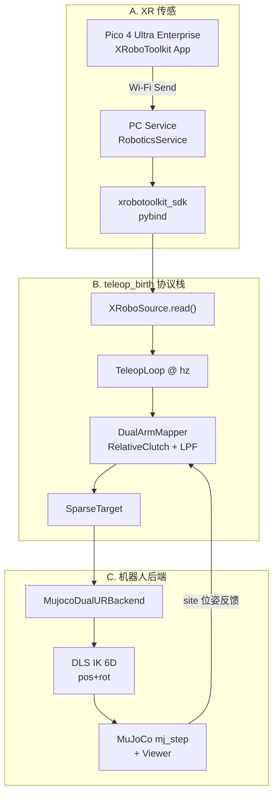
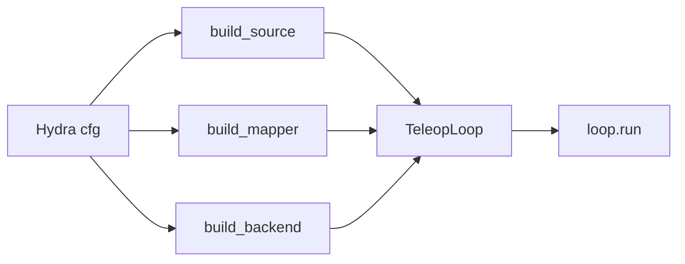
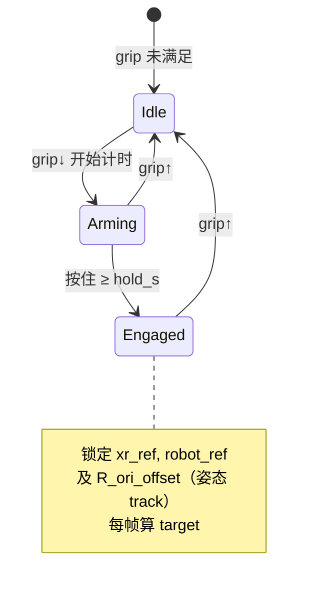
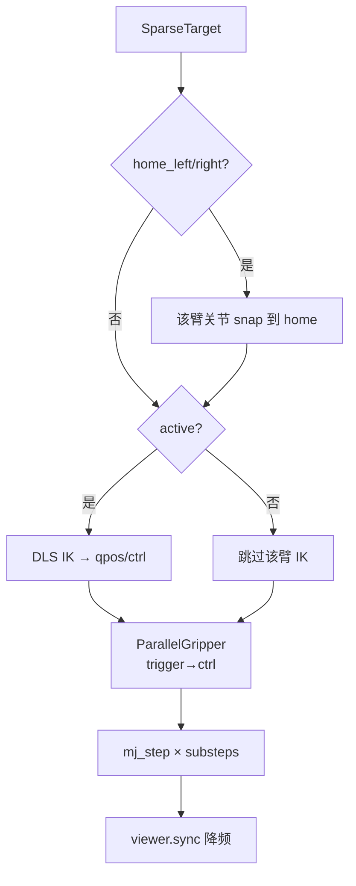
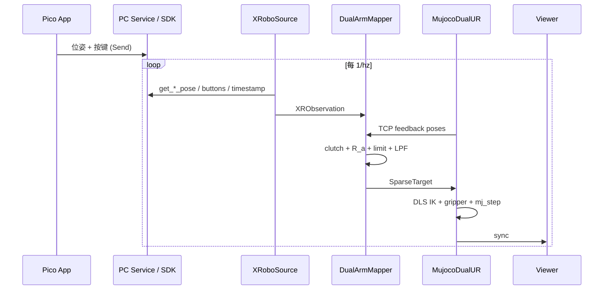

# Pico → MuJoCo 双臂遥操作：全链路详解

> 对应代码：`teleop_birth`（Progressive Extremity Teleop / PET）  
> 默认一键路径：`./start_pico_sim.sh`（约 **150 Hz**，世界系平移 + **`ori_mode=world_delta` 姿态**，夹爪加速仿真）  
> **学习向深入解析（几何 / 失败模式 / 例题）**：[遥操作算法深入解析.md](./遥操作算法深入解析.md)  
> 操作上手：见 [Pico连接指南.md](./Pico连接指南.md)  
> 架构叙事 / 论文点：见 [架构与创新点_ProgressiveExtremityTeleop.md](./架构与创新点_ProgressiveExtremityTeleop.md)

本文说明**当前仓库实际在跑的**遥操作：从手柄位姿到 MuJoCo 关节指令，每一步做什么、用什么公式、对应哪段代码；并交代参考了哪些仓库、有哪些工程创新及效果。

---

## 0. 一句话流程

```
Pico 手柄位姿 (OpenXR)
  → XRoboToolkit PC Service / SDK
  → XRObservation
  → 长按 Grip：世界系平移 Δ + track 姿态（接合锁偏移）
  → SparseTarget（左右 EE SE(3) + Trigger^γ 夹爪）
  → 6D DLS IK + 加速后的 2F-85 物理步进
  → UR5e + Robotiq MuJoCo 仿真
```

---

## 1. 系统总览（分层）



| 层 | 模块 | 输入 → 输出 | 配置入口 |
|----|------|-------------|----------|
| XR | `src/teleop_birth/xr/` | SDK → `XRObservation` | `configs/device/source/xrobo.yaml`, `configs/setup/xrobo.yaml` |
| 主循环 | `src/teleop_birth/pipeline/loop.py` | 定时 `read → map → apply` | `configs/config.yaml` → `runtime.hz` |
| 映射 | `src/teleop_birth/mapping/` + `control/` | XR + 反馈 → `SparseTarget` | `configs/algorithm/mapper/dual_arm.yaml` |
| 后端 | `src/teleop_birth/backend/mujoco_dual_ur.py` | `SparseTarget` → 关节/`ctrl` | `configs/device/backend/mujoco_dual_ur.yaml` |
| 场景 | `src/teleop_birth/sim/dual_ur5e_builder.py` | menagerie XML → `MjModel` | `paths.menagerie` |

**硬约定**：上层不把「某一套 IK 关节角」当成唯一接口；跨 embodiment 的主接口永远是 **`SparseTarget`**（稀疏末端目标）。

---

## 2. 启动与装配（一步步）

### 2.1 入口

| 入口 | 行为 |
|------|------|
| `./start_pico_sim.sh` | 拉 menagerie / 装 XRobo（若缺）→ 起 PC Service → 打印 IP → `run_teleop.py` + 一键 overrides |
| `./start.sh` | 交互菜单；可选「一键 Pico 仿真」 |
| `uv run python run_teleop.py ...` | Hydra 非交互组装 |

一键 overrides 见 `configs/setup/xrobo.yaml` → `one_click_pico_sim.overrides`（摘要）：

- `source=xrobo`, `backend=mujoco_dual_ur`, `mapper=dual_arm`
- `runtime.hz=150`, `runtime.scale=1.0`
- `mapper.delta_frame=world`, `mapper.xr_align=openxr_yup_to_zup`
- `mapper.position_only=false`, `mapper.ori_mode=world_delta`
- `mapper.gripper_gamma=0.55`
- `backend.ik.position_only=false`, `backend.ik.rot_weight=0.85`
- `backend.sim_substeps=4`；`end_effector.force_scale=16`, `extra_sim_steps=6`

### 2.2 Factory 装配顺序



伪代码（对应 `src/teleop_birth/config/factory.py` + `run_teleop.py`）：

```text
cfg ← Hydra.load("configs/config.yaml") ⊕ CLI/overrides
source  ← XRoboSource(api_names from setup/xrobo.yaml)   # 或 MockXRSource
mapper  ← DualArmMapper(mapper.yaml, scale=runtime.scale)
backend ← MujocoDualURBackend(menagerie, scene, ik, ee)
loop    ← TeleopLoop(source, mapper, backend, hz=runtime.hz)
loop.run(duration_s)   # 0 = 直到 Ctrl+C
```

---

## 3. 主循环（每帧发生什么）

对应 `TeleopLoop.run`（`src/teleop_birth/pipeline/loop.py`）。


伪代码：

```text
source.start(); backend.connect(); mapper.reset()
while running:
    t0 ← now()
    obs ← source.read()
    if obs.reconnected: mapper.reset()          # 避免旧参考猛拉
    feedback ← backend.get_feedback()           # Dict[name → pose₇]
    target ← mapper.map(obs, feedback)
    if not obs.stream_ok:
        target.active[left_ee] = target.active[right_ee] = False
    state ← backend.apply(target)
    latency.tick(obs.timestamp_ns)
    sleep(max(0, 1/hz − (now()−t0)))
```

**时序目标**：Pico 一键默认 \(f = 150\,\mathrm{Hz}\)，周期 \(\Delta t \approx 6.7\,\mathrm{ms}\)。  
**延迟探针**（同帧）：

\[
t_{\mathrm{xr\to cmd}} = \max\bigl(0,\; t_{\mathrm{now}}^{\mathrm{ns}} - t_{\mathrm{obs}}^{\mathrm{ns}}\bigr) / 10^{6}
\quad[\mathrm{ms}]
\]

另统计环路耗时 \(t_{\mathrm{loop}}\) 的 mean / p50 / p95。

---

## 4. XR 观测：从 Pico 到 `XRObservation`

### 4.1 物理链路

1. 头显 **XRoboToolkit** 打开 **WORKING + Send**  
2. 局域网发往本机 **PC Service**（`RoboticsService`）  
3. Python **`xrobotoolkit_sdk`**（本仓库编译的 pybind）读全局缓冲  
4. `XRoboSource.read()` 打成统一 schema

### 4.2 位姿约定

每路 6DoF 存成 **7 维向量**（`POSE_DIM = 7`）：

\[
\mathbf{x} = \bigl[\,p_x,\, p_y,\, p_z,\; q_x,\, q_y,\, q_z,\, q_w\,\bigr]^\top
\in \mathbb{R}^{7}
\]

齐次变换：

\[
T(\mathbf{x}) =
\begin{bmatrix}
R(\mathbf{q}) & \mathbf{p} \\
\mathbf{0}^\top & 1
\end{bmatrix}
\in SE(3)
\]

OpenXR 世界系（头显跟踪空间，**Y‑up，−Z 前**）与 MuJoCo 场景（**Z‑up，+Y 朝桌子深处**）不一致，因此映射层必须做轴对齐（第 5 节）。

### 4.3 按钮 / 夹爪语义（当前默认）

| 输入 | 作用 |
|------|------|
| **Grip** 长按 ≥ `hold_s` | 该侧 clutch **接合**，开始相对遥操 |
| 松开 Grip | **断开**，末端保持上一目标 |
| **Trigger** | 该侧夹爪开合 \(g\in[0,1]\)（与 clutch 无关，每帧更新） |
| 左手 **Y / Menu** 上升沿 | 左臂回 home + 清 clutch |
| 右手 **B / Menu** 上升沿 | 右臂回 home + 清 clutch |

掉线检测默认 **关**（`reconnect.enabled: false`）：避免手静止时被误判重连。若开启，仅用 SDK **时间戳是否停滞** 判断，不用位姿是否移动。

---

## 5. 映射核心：相对 clutch + 世界系轴对齐

实现：`RelativeClutch`（`src/teleop_birth/control/filters.py`）+ `DualArmMapper.map`（`src/teleop_birth/mapping/mappers.py`）。

### 5.1 为什么用「相对」而不是「绝对」

绝对映射会把 XR 世界原点直接当成机器人世界原点 → 接合瞬间末端**瞬移**。  
相对遥操：接合瞬间锁定 \((\mathbf{x}_{\mathrm{xr}}^{(0)},\, \mathbf{x}_{\mathrm{r}}^{(0)})\)，之后只跟**增量**。



伪代码（单臂）：

```text
function clutch_update(name, grip, xr_now, robot_now, scale):
    if not want_engage(grip):
        clear refs; return (False, None)
    if rising_edge to engaged:
        xr_ref ← xr_now
        robot_ref ← robot_now
        R_xr0_mj ← Ra @ R_xr @ R_ctrl @ Ra.T     # 可选 controller 本地修正
        R_ori_offset ← R_robot @ R_xr0_mj.T        # 使接合瞬间 cmd 姿态 = 机器人
    target ← map_delta(...)
    return (True, target)
```

### 5.2 OpenXR → MuJoCo 轴对齐矩阵 \(R_a\)

默认预设 `openxr_yup_to_zup`：

\[
R_a =
\begin{bmatrix}
1 & 0 & 0 \\
0 & 0 & -1 \\
0 & 1 & 0
\end{bmatrix}
\quad\Rightarrow\quad
\mathbf{v}_{\mathrm{MJ}} = R_a\,\mathbf{v}_{\mathrm{XR}}
\]

| XR 方向 | 映射后 MuJoCo |
|---------|----------------|
| +X（右） | +X |
| +Y（上） | +Z |
| −Z（前） | +Y（朝桌子） |

可在 YAML 用 `xr_align_matrix` 覆盖；或设 `xr_align: identity` 做消融。  
可选 `controller_quat_xyzw`：手柄本地固定旋转 \(R_{\mathrm{ctrl}}\)（grip→aim 轴修正），再参与姿态。

### 5.3 世界系平移 + 姿态模式（当前一键默认）

记接合参考与当前：

\[
\mathbf{p}_0 = \mathbf{p}_{\mathrm{xr}}^{(0)},\quad
\mathbf{p}_1 = \mathbf{p}_{\mathrm{xr}},\quad
T_{\mathrm{r}0} = T(\mathbf{x}_{\mathrm{r}}^{(0)})
\]

**平移**（始终世界系轴对齐；`scale` \(s\) 只乘位移）：

\[
\Delta\mathbf{p}_{\mathrm{MJ}} = s\, R_a\,(\mathbf{p}_1 - \mathbf{p}_0)
\qquad
\mathbf{p}_t = T_{\mathrm{r}0}\mathbf{t} + \Delta\mathbf{p}_{\mathrm{MJ}}
\]

**姿态 `ori_mode: world_delta`（默认）**

\[
R_{\Delta}^{\mathrm{XR}} = R_{\mathrm{xr}}\, R_{\mathrm{xr}0}^{\top}
\qquad
R_{\Delta}^{\mathrm{MJ}} = R_a\, R_{\Delta}^{\mathrm{XR}}\, R_a^{\top}
\qquad
R_t = R_{\Delta}^{\mathrm{MJ}}\, R_{\mathrm{r}0}
\]

房间系相对旋转左乘到接合姿态：拧腕方向与「在房间里转」一致。双臂 home 下 TCP 朝下时，竖直 yaw 也不会被取反。

**姿态 `ori_mode: track`（体轴跟随）**

先把手柄姿态改基到 MuJoCo：

\[
R_{\mathrm{xr}}^{\mathrm{MJ}}(t) = R_a\, R_{\mathrm{xr}}(t)\, R_{\mathrm{ctrl}}\, R_a^{\top}
\]

接合瞬间锁定偏移：

\[
R_{\mathrm{offset}} = R_{\mathrm{r}0}\, \bigl(R_{\mathrm{xr}}^{\mathrm{MJ}}(t_0)\bigr)^{\top}
\qquad
R_t = R_{\mathrm{offset}}\, R_{\mathrm{xr}}^{\mathrm{MJ}}(t)
\]

含义：夹爪体轴跟随对齐后的手柄朝向。仅当手柄轴与 TCP 轴大致对齐时自然；否则（例如 pinch +Z 朝下）易觉「拧反」。

**仅位置**（`position_only: true`，调试平移时用）：

\[
R_t = R_{\mathrm{r}0}
\]

腕部保持接合瞬间姿态，不跟手柄拧转。

### 5.4 旧局部系模式（`delta_frame: local`，兼容保留）

把 XR 相对变换直接乘在末端**体坐标系**：

\[
T_{\Delta} = T(\mathbf{x}_{\mathrm{xr}}^{(0)})^{-1}\, T(\mathbf{x}_{\mathrm{xr}})
\qquad
T_t = T_{\mathrm{r}0}\, \tilde{T}_{\Delta}
\]

其中 \(\tilde{T}_{\Delta}\) 的平移/旋转仍经 \(R_a\) 处理。该模式在「手柄坐标系 ≠ 夹爪坐标系」时，常出现**拧的方向不对**；开 `ori_mode=track` 时局部系分支会回落到与世界系相同的 track 姿态逻辑。
### 5.5 Mapper 后处理流水线

接合成功后，对目标位姿依次：


1. **限步**  
   \[
   \mathbf{p}' =
   \begin{cases}
   \mathbf{p}_{\mathrm{prev}} + \Delta\mathbf{p}\cdot\frac{d_{\max}}{\|\Delta\mathbf{p}\|}
     & \|\Delta\mathbf{p}\| > d_{\max} \\
   \mathbf{p} & \text{否则}
   \end{cases}
   \]
   姿态同理用轴角截断到 `max_step_rad`（仅非 `position_only`）。

2. **工作空间球**  
   \[
   \|\mathbf{p} - \mathbf{c}\| \le r_{\mathrm{ws}}
   \]
   超出则投影到球面（左右臂各自 `workspace_center`）。

3. **低通**（`filter_alpha = α`，默认 0.95）  
   \[
   \mathbf{p}_k = (1-\alpha)\,\mathbf{p}_{k-1} + \alpha\,\mathbf{p}^{\mathrm{raw}}
   \]
   四元数做同半球混合后归一化。

4. **未接合**：`active=False`，输出上一帧目标（后端对该臂跳过 IK 更新语义上「保持」）。

夹爪（与 clutch 独立）：

\[
g_{\mathrm{raw}} = \mathrm{clip}(\mathrm{trigger},\,0,\,1)
\qquad
g = g_{\mathrm{raw}}^{\gamma}
\quad(\gamma=\texttt{gripper\_gamma},\ \text{默认 }0.55)
\]

\(\gamma<1\) 使中段 Trigger 更灵敏、更快接近闭合。  
仿真侧：`ParallelGripper` 把 \(g\) 映到 ctrl \([0,255]\)；`force_scale` / `kp_scale` / `kv_scale` 放大 Menagerie 2F‑85 执行器；每控帧 `sim_substeps + extra_sim_steps` 次 `mj_step`，否则墙钟下开合极慢。
### 5.6 `DualArmMapper.map` 伪代码汇总

```text
for each side in {left, right}:
    if reset_button rising edge:
        clutch.reset(side); lpf.reset(side)
        meta.home_side ← True; active ← False; continue

    robot ← feedback[side] or last[side]
    engaged, raw ← clutch.update(side, grip, xr, robot, scale)
    active[side] ← engaged
    if engaged:
        raw ← limit_step(raw)
        raw ← clamp_workspace(raw)
        raw ← lpf.filter(raw)
        last[side] ← raw
    extremities[side] ← last[side]

SparseTarget ← {extremities, active, grippers, meta}
```

---

## 6. 后端：MuJoCo 双 UR + DLS IK

### 6.1 场景

- 资产：`third_party/mujoco_menagerie` 的 `universal_robots_ur5e` + `robotiq_2f85`
- 组装：`build_dual_ur5e_2f85` → 左右前缀 `L_` / `R_`，TCP site（pinch）
- 基座约在 \(x=\pm\texttt{base_x}\)，桌面沿 +Y

反馈：`get_feedback()` 读 site 的 `xpos` + `xmat` → 转回 7D pose，供 clutch 锁定 `robot_ref`。

### 6.2 `apply` 流程



### 6.3 阻尼最小二乘 IK（Damped Least Squares）— `ik.solver: dls`

记任务误差 \(\mathbf{e}\in\mathbb{R}^{n}\)（`position_only` 时 \(n=3\)，否则 \(n=6\)），关节相关雅可比 \(J\in\mathbb{R}^{n\times 6}\)（单臂 6 轴）：

**位置误差**

\[
\mathbf{e}_p = w_p\,(\mathbf{p}^{\mathrm{des}} - \mathbf{p})
\]

**姿态误差**（启用时）：由 \(R_{\mathrm{err}} = R^{\mathrm{des}} R^{\top}\) 取 vee 近似，再乘 \(w_r\)。

迭代（最多 `ik.iters`）：

\[
\Delta\mathbf{q}
=
J^{\top}
\bigl(J J^{\top} + \lambda I\bigr)^{-1}
\mathbf{e}
,\qquad
\Delta\mathbf{q}
\leftarrow
\mathrm{clip}(\Delta\mathbf{q},\, -\Delta q_{\max},\, \Delta q_{\max})
\]

写入 `qpos` 与 `ctrl`，再 `mj_forward`，直到 \(\|\mathbf{e}\| < \varepsilon\) 或用尽迭代。

一键默认：**6D IK**（`backend.ik.position_only=false`, `rot_weight≈0.85`），与 mapper 全姿态一致。  
调试平移时可两边同时改回 `position_only=true`。

**可切换求解器**（`backend.ik.solver`）：`dls`（上式）| `ssik`（[解析 IK](https://github.com/personalrobotics/ssik)）| `curobo`（[GPU IK](https://curobo.org/)）。详见 [IK求解器切换.md](./IK求解器切换.md)。失败时 `fallback: dls`。

夹爪：见 §5 末；后端 `_boost_gripper_actuators` 在 `connect` 时改写 `forcerange` / `biasprm` / `gainprm`。
---

## 7. 端到端数据流（合并视图）



**操作员侧最小闭环**

1. WORKING + Send  
2. 长按 Grip ≥ `hold_s`  
3. 平移手柄 → 末端同向移动（轴对齐后）  
4. Trigger 夹爪；Y/B 回零；松 Grip 悬停  

---

## 8. 参考了哪些仓库 / 论文，参考了什么

本仓库**不是**对某一完整遥操栈的 fork，而是：锁定 Pico 传感底座 + 自研协议与控制层，仿真资产与 SDK 来自开源生态。对照如下。

### 8.1 直接依赖 / 运行时集成（代码会调用）

| 来源 | 仓库 / 制品 | 本仓库怎么用 |
|------|-------------|--------------|
| **XRoboToolkit** | [Unity-Client](https://github.com/XR-Robotics/XRoboToolkit-Unity-Client)、[PC-Service](https://github.com/XR-Robotics/XRoboToolkit-PC-Service)、[PC-Service-Pybind](https://github.com/XR-Robotics/XRoboToolkit-PC-Service-Pybind)；论文 [arXiv:2508.00097](https://arxiv.org/abs/2508.00097) | Pico APK + PC Service + 本地编译 `xrobotoolkit_sdk`；**只取传感/通信**，不用其样例里的整段双臂 QP‑IK 应用层 |
| **MuJoCo Menagerie** | [google-deepmind/mujoco_menagerie](https://github.com/google-deepmind/mujoco_menagerie) | UR5e、Robotiq 2F‑85 模型 XML；`dual_ur5e_builder` 拼双臂桌面场景 |
| **MuJoCo** | DeepMind MuJoCo | `mj_jacSite` / `mj_step` / passive viewer；IK 为自写 DLS |

安装落点：`third_party/`（gitignore，由 `bootstrap_third_party.sh` / `install_xrobo.sh` 拉取）。

### 8.2 架构与接口思想上的参考（未 vendoring 其控制栈）

| 工作 | 参考点 | 本仓库落点 |
|------|--------|------------|
| **HuMiT** | 稀疏关键点 / 最小参考、低延迟人形叙事 | `SparseTarget.keypoints` 预留；文档阶段路线 |
| **ExtremControl** ([arXiv:2602.11321](https://arxiv.org/abs/2602.11321), Genesis‑Humanoid) | 末端 SE(3) 目标、速度前馈思路 | `SparseTarget` 以 EE SE(3) 为主；`estimate_pose_velocity` 注释为 ExtremControl‑style（给后续前馈） |
| **MOSAIC（智源）** | 多接口残差、长时稳健 | related work；Backend 可插策略的叙事 |
| **TWIST2 / GR00T‑WBC** | Pico + XRobo 全身采数生态事实 | 选型文档；非当前双臂主路径实现 |
| **Unitree xr_teleoperate** | G1 产品路径、Pico Enterprise 兼容声明 | `G1BackendStub` 占位 |
| **BEAVR 等** | 多 embodiment 解耦 | 强化「Source / Mapper / Backend 分层」 |
| **XRobo Teleop‑Sample‑Python** | 双 UR / MuJoCo 样例如何接线 | **对照验证**传感 API 与任务形态；本仓库自研 clutch/映射/Hydra/一键流程，非逐文件移植 |
| 内部 **data_process** 式 CLI | 交互菜单 + YAML 驱动 | `src/teleop_birth/cli/` + `configs/ui/menu.yaml` |

更完整的调研表见 [pico_teleop_方案调研与选型.md](./pico_teleop_方案调研与选型.md)。

### 8.3 明确「没有照搬」的部分

- 未嵌入 XRobo 样例的完整 QP‑IK / 真机驱动应用  
- 未嵌入 HuMiT / ExtremControl / MOSAIC 的策略网络权重  
- 相对遥操的 **世界系 \(R_a\) 对齐 + 长按 clutch + Hydra 全配置化** 为本仓库工程实现  

---

## 9. 创新点与当前效果

### 9.1 主张的创新（相对「直接跑厂商样例」）

| # | 创新 | 含义 | 当前可观测效果 |
|---|------|------|----------------|
| 1 | **Progressive Extremity / `SparseTarget` 协议** | 双臂与人形共用稀疏 SE(3)（+ 可选关键点）接口；换机器人只换 Backend | 已落地双臂仿真闭环；人形 `HumanoidMapper` / `G1BackendStub` 同协议预留 |
| 2 | **传感与控制解耦** | XR 层锁定 XRobo；映射/IK/策略可替换 | 同一 `TeleopLoop` 可切 `mock` / `xrobo`、`mock_dual_arm` / `mujoco_dual_ur` |
| 3 | **世界系相对遥操 + OpenXR→MuJoCo 轴对齐** | \(\Delta\mathbf{p}_{\mathrm{MJ}}=s R_a\Delta\mathbf{p}_{\mathrm{XR}}\)；避免局部系「拧反」 | 平移方向与「前/上/右」语义一致（默认预设）；可用矩阵消融 |
| 4 | **长按 Grip clutch + 单臂复位** | 防飞车；左右独立 home | 松手悬停；Y/B 回零不互相干扰 |
| 5 | **姿态 world_delta + 世界系平移** | \(R_t=R_\Delta^{\mathrm{MJ}}R_{\mathrm{r}0}\)；平移 \(R_a\Delta p\) | 房间拧腕方向一致；可切 `track` / `position_only` |
| 6 | **夹爪仿真加速** | Trigger\(^\gamma\) + 力矩放大 + 额外 `mj_step` | 墙钟下开合明显快于裸 Menagerie 默认 |
| 7 | **YAML/Hydra + 一键 Pico** | 无硬编码魔法数；无需 sudo 解压 PC Service | `./start_pico_sim.sh` 可复现实验配置 |
| 8 | **可测延迟钩子** | `LatencyProbe` 统一口径 | 为论文对比预留 loop / xr→cmd 统计 |

### 9.2 效果边界（诚实表述）

**已具备**

- Pico → 双 UR5e MuJoCo：**稳定相对遥操**（需 Send + 长按 Grip）  
- 约 **150 Hz** 控制环；夹爪 Trigger 独立且仿真加速  
- 轴对齐后**平移跟手**；**track 姿态**跟拧腕  
- 配置与依赖安装可复现（menagerie / XRobo 自动拉）

**尚非论文级已证伪主张**

- 端到端光学对齐延迟、任务成功率等**尚未**在文档中给出正式实验数字  
- 人形全身、HuMiT/ExtremControl Backend **未**实机跑通  
- 真机 UR 驱动未接；当前效果锚在**仿真**  

**务实结论**：工程创新落在 **统一稀疏协议 + 渐进扩展 + 跟手相对映射/轴对齐/clutch**；学术故事需建立在后续延迟与任务实验上，而不是「另造一个 Pico SDK」。

---

## 10. 关键文件索引

| 主题 | 路径 |
|------|------|
| 相对 clutch / \(R_a\) | `src/teleop_birth/control/filters.py` |
| 双臂映射 | `src/teleop_birth/mapping/mappers.py` |
| 主循环 | `src/teleop_birth/pipeline/loop.py` |
| XR 适配 | `src/teleop_birth/xr/sources.py` |
| IK / 仿真后端 | `src/teleop_birth/backend/mujoco_dual_ur.py` |
| 场景拼装 | `src/teleop_birth/sim/dual_ur5e_builder.py` |
| Schema | `src/teleop_birth/schema/` |
| 一键参数 | `configs/setup/xrobo.yaml`, `configs/algorithm/mapper/dual_arm.yaml` |
| 单测（轴对齐等） | `tests/test_protocol.py` |

---

## 11. 调参速查（跟手相关）

| 参数 | 默认（一键） | 作用 |
|------|--------------|------|
| `mapper.delta_frame` | `world` | 平移用世界系相对（推荐） |
| `mapper.xr_align` | `openxr_yup_to_zup` | 轴对齐预设 |
| `mapper.position_only` | `false` | 跟位置+姿态 |
| `mapper.ori_mode` | `world_delta` | 房间系相对旋转（默认）；`track` 为体轴跟随 |
| `mapper.gripper_gamma` | `0.55` | Trigger 曲线，越小中段越灵敏 |
| `mapper.filter_alpha` | `0.92` | 越大越跟手、越小越稳 |
| `mapper.max_step_m` | `0.08` | 每帧最大位移 |
| `mapper.max_step_rad` | `0.45` | 每帧最大转角 |
| `mapper.hold_s` | `0.2` | 长按判定 |
| `runtime.scale` | `1.0` | 位移倍率 |
| `runtime.hz` | `150` | 控制频率 |
| `backend.ik.rot_weight` | `0.85` | 姿态任务权重 |
| `backend.sim_substeps` | `4` | 每控帧物理步 |
| `end_effector.force_scale` | `16` | 夹爪力矩放大 |
| `end_effector.extra_sim_steps` | `6` | 额外物理步（加速闭合） |

若某轴仍反了：优先改 `xr_align_matrix` / `controller_quat_xyzw`，不要先改 IK。