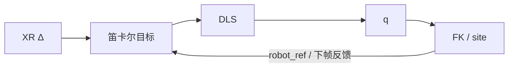

# 遥操作算法深入解析（学习向）

> 目标：不只记住「流程」，而是理解**每个算子在几何上做什么、为什么这样写、错了会怎样、和代码哪一行对应**。  
> 配套：流程与配置索引见 [遥操作全链路详解.md](./遥操作全链路详解.md)；上手见 [Pico连接指南.md](./Pico连接指南.md)。  
> 代码锚点：`src/teleop_birth/control/filters.py`、`mapping/mappers.py`、`backend/mujoco_dual_ur.py`、`schema/types.py`。

建议阅读顺序：§1 位姿 → §2 绝对/相对 → §3 世界系平移与腕部姿态 → §4 clutch → §5 滤波安全 → §6–7.5 IK 与夹爪 → §8 延迟 → §9 例题 → §12 自测。

---

## 1. 位姿：遥操里真正在搬的对象是什么

### 1.1 为什么用 \(SE(3)\)，而不是「三个数 xyz」

机械臂末端（夹爪 pinch site）在空间里有：

- **位置** \(\mathbf{p}\in\mathbb{R}^3\)：夹在哪里  
- **姿态** \(R\in SO(3)\)：夹爪朝哪、绕哪扭  

合在一起是刚体位姿，李群 \(SE(3)\)：

\[
T =
\begin{bmatrix}
R & \mathbf{p} \\
\mathbf{0}^\top & 1
\end{bmatrix}
\in SE(3)
\]

本仓库对外用紧凑向量（**不是**李代数 \(\mathfrak{se}(3)\)）：

\[
\mathbf{x}=[p_x,p_y,p_z,\,q_x,q_y,q_z,q_w]^\top
\quad\text{（四元数 xyzw）}
\]

互转见 `pose_to_matrix` / `matrix_to_pose`（`schema/types.py`）。  
学习时请记住：**算法推导一律用 \(T\)；落盘/传参用 \(\mathbf{x}\)**。

### 1.2 组合与逆：相对运动的代数

\[
T_{ac}=T_{ab}\,T_{bc}
\qquad
T^{-1}=
\begin{bmatrix}
R^\top & -R^\top\mathbf{p} \\
\mathbf{0}^\top & 1
\end{bmatrix}
\]

代码：`multiply_poses(a,b)`、`invert_pose`。  
含义：

- \(T_{ab}\)：「从坐标系 \(b\) 变到 \(a\)」或「物体在 \(a\) 下的位姿，相对 \(b\)」——阅读时要固定「左乘/右乘约定」。  
- 本仓库约定与多数机器人学教材一致：**左乘 = 在固定（世界）系里再变换；右乘 = 在物体（局部）系里再变换**。

### 1.3 四元数为何要「同半球混合」

四元数 \(q\) 与 \(-q\) 表示同一旋转。低通里若 \(\mathbf{q}_{k-1}\cdot\mathbf{q}^{\mathrm{raw}}<0\)，会先取反再插值（`PoseLowPass`），否则插值路径会绕远路，出现姿态跳变。这是**表示奇异**，不是物理突变。

---

## 2. 绝对遥操 vs 相对遥操（设计分叉的根源）

### 2.1 绝对映射（本仓库不用作主路径）

\[
T_{\mathrm{robot}}^{\mathrm{cmd}}(t)=
\Phi\bigl(T_{\mathrm{XR}}(t)\bigr)
\]

\(\Phi\) 是某个固定的「XR 世界 → 机器人世界」刚体标定。问题：

| 现象 | 原因 |
|------|------|
| 一点 Grip 就飞出去 | \(T_{\mathrm{XR}}\) 与 \(T_{\mathrm{robot}}\) 原点/朝向差很大，\(\Phi\) 瞬间给出远处目标 |
| 依赖标定质量 | 头显原点、桌面原点必须准 |
| 松手难「悬停」 | 绝对流一直在更新，除非另做保持逻辑 |

### 2.2 相对映射（本仓库主路径）

在接合瞬间 \(t_0\) 锁定参考：

\[
T_{\mathrm{XR}}^{(0)}=T_{\mathrm{XR}}(t_0),\quad
T_{\mathrm{r}}^{(0)}=T_{\mathrm{robot}}(t_0)
\]

之后只跟随**相对运动** \(\Delta\)，再叠回机器人参考。  
直觉：**「从我按下的那一刻起，手怎么动，臂尖就怎么动」**，而不是「手在房间里的绝对坐标 = 臂在桌子上的绝对坐标」。

平移和姿态只用一种几何，见下一节。

---

## 3. 世界系平移 + 腕部姿态

### 3.1 平移：先换轴，再在房间里相加

本仓库默认：

\[
\Delta\mathbf{p}_{\mathrm{XR}}=\mathbf{p}(t)-\mathbf{p}^{(0)}
\qquad
\Delta\mathbf{p}_{\mathrm{MJ}}= s\, R_a\,\Delta\mathbf{p}_{\mathrm{XR}}
\qquad
\mathbf{p}_{\mathrm{cmd}}=\mathbf{p}_{\mathrm{r}}^{(0)}+\Delta\mathbf{p}_{\mathrm{MJ}}
\]

要点：手往「房间的前方」动，臂往「桌子的前方」动——前提是 \(R_a\) 把两个「前方」对齐。对应 `RelativeClutch._map`。

### 3.3 为什么旋转改基要用 \(R_a R R_a^{\top}\)

向量：\(\mathbf{v}_{\mathrm{MJ}}=R_a\mathbf{v}_{\mathrm{XR}}\)。  
旋转是作用在向量上的算子。若在 XR 里 \(R_{\mathrm{XR}}\mathbf{v}_{\mathrm{XR}}\)，到 MJ 里应满足：

\[
R_{\mathrm{MJ}}(R_a\mathbf{v}_{\mathrm{XR}})
=
R_a(R_{\mathrm{XR}}\mathbf{v}_{\mathrm{XR}})
\;\Rightarrow\;
R_{\mathrm{MJ}}=R_a R_{\mathrm{XR}} R_a^{\top}
\]

这是线性代数的**共轭 / 改基**，不是随意多乘一个矩阵。漏写 \(R_a^{\top}\) 会把姿态跟手彻底弄坏。

### 3.4 姿态：房间 yaw + 夹爪体轴拧腕

夹爪 home 朝下、手柄通常平指前方。把整段房间旋转左乘到 TCP 上，会把朝下的接近轴翻开，拧腕也和手柄体轴对不上。所以拆成两段（`position_only: false`）：

\[
\psi = \operatorname{atan2}(R_{\Delta}^{\mathrm{MJ}}{}_{1,0},\, R_{\Delta}^{\mathrm{MJ}}{}_{0,0})
,\quad
R_{\mathrm{yaw}}=\mathrm{Rot}_z(\psi)
\]

\[
\mathbf{w}=\mathrm{axis\text{-}angle}(R_{x0}^{\top} R_x),\quad w_y\leftarrow 0
,\quad
R_{\mathrm{cmd}}=R_{\mathrm{yaw}}\,R_{\mathrm{r}}^{(0)}\,\mathrm{Rot}(M\mathbf{w})
\]

\(M\) 把握把右送到工具右，把绕瞄准轴的拧送到绕接近轴的拧。\(R_{\mathrm{ctrl}}\)（`controller_quat_xyzw`）只在握把轴和瞄准轴差一个固定角时插入，默认单位阵。接合瞬间 \(\mathbf{w}=0\)、\(\psi=0\)，所以不会瞬移。

### 3.5 `position_only`：关掉姿态通道（调试平移用）

\[
R_{\mathrm{cmd}}=R_{\mathrm{r}}^{(0)}
\]

| 收益 | 代价 |
|------|------|
| 操作心智 =「挪点」；不受握持姿态噪声干扰 | 不能拧腕对准 |
| IK 可降为 3D | 精细姿态任务不够 |

只测平移时设 `position_only=true`。没有第二种姿态公式。

---

## 4. 轴对齐 \(R_a\)：两个「世界」之间的线性改基

### 4.1 两套习惯

| | OpenXR（Pico 跟踪空间） | 本仿真 MuJoCo 桌面习惯 |
|--|-------------------------|-------------------------|
| 上 | \(+Y\) | \(+Z\) |
| 前 | \(-Z\) | \(+Y\)（朝桌子深处） |
| 右 | \(+X\) | \(+X\) |

默认矩阵（`openxr_yup_to_mujoco_zup`）：

\[
R_a=
\begin{bmatrix}
1&0&0\\
0&0&-1\\
0&1&0
\end{bmatrix}
\qquad
R_a\begin{bmatrix}x\\y\\z\end{bmatrix}_{\mathrm{XR}}
=
\begin{bmatrix}x\\-z\\y\end{bmatrix}_{\mathrm{MJ}}
\]

检验：

- XR 前向 \(\mathbf{e}_f=(0,0,-1)\) → \(R_a\mathbf{e}_f=(0,1,0)\) = MJ \(+Y\)  
- XR 上向 \(\mathbf{e}_u=(0,1,0)\) → \(R_a\mathbf{e}_u=(0,0,1)\) = MJ \(+Z\)

### 4.2 \(R_a\) 错了时的「症状词典」（学习调试用）

| 你动手 | 臂的反应 | 可能问题 |
|--------|----------|----------|
| 前推 | 抬高/下降 | 前轴与上轴对调或符号错 |
| 前推 | 左右移 | 前轴映到了 \(\pm X\) |
| 右移 | 左移 | \(X\) 行符号反了（镜像） |
| 平移对、一拧就疯 | | 先 `position_only=true` 确认平移；握把轴和瞄准轴差固定角时再调 `controller_quat_xyzw` |

改 \(R_a\) 时用 YAML `xr_align_matrix`，用单测 `test_clutch_world_axis_remap_forward` 锁住「前 → +Y」契约。

### 4.3 与「标定外参」的区别

完整手眼标定是 \(SE(3)\) 外参 \(T_{\mathrm{MJ}\leftarrow\mathrm{XR}}\)（含平移）。  
本仓库相对模式**不需要**平移外参：因为只用 \(\Delta\mathbf{p}\)，常数原点差被差分消掉。  
\(R_a\) 只解决**轴向习惯不一致**；若头显 yaw 相对桌子转了 \(45^\circ\)，严格说还应再乘一个绕竖直轴的旋转——那是场景摆放/站位问题，可用自定义 `xr_align_matrix` 吸收。

---

## 5. Clutch：把连续跟踪变成「可中断的相对会话」

### 5.1 为什么要 clutch

没有 clutch：每一帧 XR 噪声和微小漂移都会进 IK。  
有 clutch：只有「我声明在控」的时段才更新目标；松开保持 \(\mathbf{x}_{\mathrm{last}}\)。

### 5.2 长按作为防误触滤波器

`long_press_grip`：grip 超过阈值后还要持续 `hold_s` 才接合。

\[
\mathrm{engaged}(t)=\mathbf{1}\bigl[\forall \tau\in[t_0,t]:\mathrm{grip}(\tau)\ge\theta\bigr]
\;\wedge\;
(t-t_0)\ge t_{\mathrm{hold}}
\]

这是在时间轴上的**迟滞**：把「蹭到 grip」从「真想开始」里分开。

### 5.3 接合瞬间的信息论含义

锁定 \((T_{\mathrm{XR}}^{(0)}, T_{\mathrm{r}}^{(0)})\) 等于选定：

> 相对会话的零点 = 此刻人机位姿差。

因此 **重连 / home 后必须 `mapper.reset()`**：否则旧零点 + 新反馈 → 相对 \(\Delta\) 爆炸（代码里 `reconnected` 分支专门处理）。

### 5.4 左右独立

左、右各有一套 `ClutchState`。可单手作业、单臂回零，不会「按一下 Y 两只臂都清」。

---

## 6. 后处理：限步、工作空间、低通——三层不同的「稳」

它们不是重复旋钮，约束的对象不同：

| 模块 | 约束对象 | 数学角色 |
|------|----------|----------|
| `max_step_m` / `max_step_rad` | **相邻控制周期**的增量 | 速率限制（rate limit），防单帧尖峰 |
| `workspace_radius_m` | 相对臂工作球心的位置 | 集合约束（投影到球） |
| `filter_alpha` | 目标时间序列平滑 | 一阶 IIR 低通 |

### 6.1 低通离散形式

\[
\mathbf{p}_k=(1-\alpha)\mathbf{p}_{k-1}+\alpha\mathbf{p}^{\mathrm{raw}}
\]

\(\alpha\to 1\)：更跟手、更噪；\(\alpha\to 0\)：更稳、更拖。  
在固定 \(f_s=\mathrm{hz}\) 下，可粗看成连续时间 \(\dot p=-(1-\alpha)f_s\,(p-p^{\mathrm{raw}})\) 的欧拉离散——**截止频率随 hz 变**，所以改 `runtime.hz` 时体感会变，不是单纯「更快」。

### 6.2 限步与低通的先后

代码顺序：`clutch → limit_step → clamp_workspace → lpf`。

- 先限步：避免坏帧（追踪丢包跳变）在进滤波器前注入超大冲激。  
- 再工作空间：物理可达性硬边界。  
- 最后低通：在合法集合附近做平滑（注意：严格说投影后再滤，偶发会轻微出界一帧，工程上可接受）。

---

## 7. IK：从笛卡尔目标到关节——阻尼最小二乘在干什么

### 7.1 正运动学与任务误差

单臂 \(\mathbf{q}\in\mathbb{R}^6\)，site 位姿 \(T(\mathbf{q})\)。  
位置任务：

\[
\mathbf{e}_p=w_p\bigl(\mathbf{p}^{\mathrm{des}}-\mathbf{p}(\mathbf{q})\bigr)
\]

全姿态时再拼姿态误差（代码用 \(R_{\mathrm{err}}=R^{\mathrm{des}}R^{\top}\) 的 vee 近似，见 `_mat_to_6err`）。

### 7.2 一次牛顿步与阻尼

雅可比 \(J=\partial\mathbf{e}/\partial\mathbf{q}\)（MuJoCo `mj_jacSite` 取与臂相关列）。  
无阻尼最小二乘：

\[
\min_{\Delta\mathbf{q}}\ \|J\Delta\mathbf{q}-\mathbf{e}\|^2
\;\Rightarrow\;
J^{\top}J\,\Delta\mathbf{q}=J^{\top}\mathbf{e}
\]

近奇异时 \(J^{\top}J\) 病态 → \(\Delta\mathbf{q}\) 爆炸（腕部乱抖）。  
**Damped Least Squares（Tikhonov）**：

\[
\min_{\Delta\mathbf{q}}\ \|J\Delta\mathbf{q}-\mathbf{e}\|^2+\lambda\|\Delta\mathbf{q}\|^2
\]

正规方程（对瘦高/胖胖 \(J\) 用右侧形式更稳）：

\[
\Delta\mathbf{q}
=
J^{\top}\bigl(JJ^{\top}+\lambda I\bigr)^{-1}\mathbf{e}
\]

再 \(\mathrm{clip}(\Delta\mathbf{q},\,\pm\Delta q_{\max})\)，写回 `qpos`/`ctrl`，迭代 `ik.iters` 次。

### 7.3 姿态 IK 必须与 mapper 对齐

| Mapper | Backend IK | 结果 |
|--------|------------|------|
| `position_only=true` | `position_only=true` | 腕部保持，只追位置 |
| `position_only=false` | `position_only=false` | 正常跟姿态（一键默认） |
| mapper 开姿态、IK 只位置 | | 命令有姿态但关节不跟 →「姿态没反应」 |
| mapper 只位置、IK 开姿态 | | 仍可能因姿态误差拧腕（应避免） |

一键：两边都 `position_only=false`，`rot_weight=0.30`。TCP 离目标超过 2 cm 时这一拍只追位置，靠近后再在位置零空间里补姿态。

### 7.4 为什么每帧要 `get_feedback` 进 mapper

Clutch 的 \(T_{\mathrm{r}}^{(0)}\) 来自**真实（仿真）TCP**，不是上一拍命令。  
若只用开环命令当参考：IK 跟踪误差会累积进相对零点，出现「越控越偏」。  
反馈闭合是相对遥操正确性的一部分，不是可有可无的日志。

---

## 7.5 夹爪为什么「慢」——以及怎么加快（仿真特有）

Trigger 每帧都进 `SparseTarget`，**不是**被 clutch 挡住。慢的主因在 **MuJoCo 里 2F‑85 执行器动力学**：

- Menagerie 默认 `forcerange="-5 5"`，力矩上限很低；  
- 位置型 `general` 执行器带较大阻尼（`biasprm`）；  
- 若每控帧只 `mj_step` 1 次，墙钟时间远快于仿真时间，肉眼觉得「扣了半天才合拢」。

本仓库加速手段（`configs/device/end_effector/gripper.yaml` + backend）：

| 手段 | 作用 |
|------|------|
| `force_scale` | 放大 `actuator_forcerange` |
| `kp_scale` / `kv_scale` | 调 `gainprm`/`biasprm`，更跟目标、少拖沓 |
| `sim_substeps` + `extra_sim_steps` | 每控帧多跑物理，闭合更快「赶」上 Trigger |
| `gripper_gamma` | \(g=t^{\gamma}\)，\(\gamma<1\) 中段更灵敏 |

公式：

\[
g = \mathrm{clip}(t_{\mathrm{trigger}},0,1)^{\gamma}
\qquad
u_{\mathrm{ctrl}} = u_{\mathrm{open}} + g\,(u_{\mathrm{closed}}-u_{\mathrm{open}})
\]

学习点：**命令频率高 ≠ 被控对象响应快**；夹爪慢要分清是映射层还是执行器/仿真步。

---

## 8. 延迟、频率与「跟手」的系统视角

### 8.1 延迟预算（概念分层）

\[
T_{\mathrm{e2e}}
\approx
T_{\mathrm{track}}+T_{\mathrm{net}}+T_{\mathrm{sdk}}
+T_{\mathrm{map}}+T_{\mathrm{ik}}+T_{\mathrm{sim/act}}
+T_{\mathrm{display}}
\]

本仓库 `LatencyProbe` 能直接估的是：

- \(t_{\mathrm{loop}}\)：本进程一圈墙钟时间  
- \(t_{\mathrm{xr\to cmd}}\)：SDK 时间戳 → 本机 `apply` 前（含 map）

**不包含**头显光子到视网膜、也不自动含显示器刷新——论文对比要另做光学对齐。

### 8.2 提高 `hz` 不等于线性降延迟

- 周期上限 \(1/f\) 变小，但若 IK+渲染 > 周期，只会**赶不上**（sleep 为 0）。  
- 滤波器等效带宽随 \(f\) 变（§6.1）。  
- `max_step_m` 是「每周期」上限：同样手速，更高频下每步更碎，体感可能更顺，但总速度仍被 `scale` 与工作空间限制。

### 8.3 `scale` 的真正含义

\[
\Delta\mathbf{p}_{\mathrm{MJ}}=s\,R_a\Delta\mathbf{p}_{\mathrm{XR}}
\]

\(s>1\)：手小动、臂大动（工作空间放大，误差与噪声也被放大）。  
\(s=1\)：米制近似 1:1（仍受轴对齐与限步约束）。

---

## 9. 数值例题（建议手算一遍）

### 例 A：世界系纯平移

接合：\(\mathbf{p}_{\mathrm{r}}^{(0)}=(0,0.4,0.5)\)，\(R_a\) 为默认，\(s=1\)。  
XR：\(\mathbf{p}^{(0)}=\mathbf{0}\)，\(\mathbf{p}=(0,0,-0.1)\)（前 10 cm）。

\[
\Delta\mathbf{p}_{\mathrm{MJ}}=R_a\begin{bmatrix}0\\0\\-0.1\end{bmatrix}
=\begin{bmatrix}0\\0.1\\0\end{bmatrix}
\Rightarrow
\mathbf{p}_{\mathrm{cmd}}=(0,0.5,0.5)
\]

与单测 `test_clutch_world_axis_remap_forward` 一致。

### 例 B：为什么拧腕不走房间整段旋转

夹爪接近轴朝下，手柄瞄准轴通常朝前。把房间里的整段旋转左乘到 TCP 上，接近轴会被翻开，手柄体轴上的拧也会映到夹爪的另一根轴。  
平移只走 \(R_a\)。姿态里，绕竖直轴的左右转仍用房间 yaw；绕瞄准轴的拧经 \(M\) 改到绕接近轴。握把和瞄准差一个固定角时，用 \(R_{\mathrm{ctrl}}\) 修正。

### 例 C：DLS 奇异直觉

腕部接近奇异时 \(J\) 最小奇异值 \(\sigma_{\min}\to 0\)。无阻尼步长 \(\sim 1/\sigma_{\min}\)；有阻尼时有效 \(\sim \sigma/(\sigma^2+\lambda)\)，在 \(\sigma\to0\) 时趋于 0——**用跟踪误差换稳定性**。\(\lambda\) 过大则「呆」；过小则「抖」。

### 例 D：房间 yaw 与拧腕分开

手柄绕头显的上转 +90°，TCP 朝下时，目标也绕房间 +Z 转 +90°，接近轴仍朝下。  
绕握把瞄准轴拧时，增量右乘到夹爪体轴，接近方向不变。与单测 `test_clutch_wrist_yaw_and_roll` 一致。

---

## 10. 和参考系统的算法关系（学习迁移）

| 概念 | 常见来源 | 本仓库怎么用 |
|------|----------|--------------|
| XR 位姿流 | XRoboToolkit | 只消费 pose/button；不用其样例 QP 应用层 |
| 相对 clutch | 大量 VR 遥操工程实践 | 自研状态机 + 左右独立 home |
| 末端 SE(3) 目标 | ExtremControl 等 | `SparseTarget` 总线；速度估计函数预留 |
| 稀疏关键点 | HuMiT | schema 预留，双臂阶段未强制 |
| DLS IK | 机器人学标准工具 | 自写迭代 + MuJoCo 雅可比 |
| 轴对齐 \(R_a\) | OpenXR↔机器人惯例 | 显式矩阵 + 可配置，可消融 |

**创新点若用算法语言说**：稀疏 SE(3) 总线 + 「世界系平移 / 腕部姿态 / \(R_a\) / clutch」管道 + 夹爪仿真跟手调参，而不是再包一层厂商 Demo。

---

## 11. 对照代码阅读路线（建议 60–90 分钟）

1. `schema/types.py`：`pose_to_matrix` / `multiply_poses` — 建立 \(T\) 心智。  
2. `control/filters.py`：`_map`（房间平移、房间 yaw、\(M\) 拧腕）、`openxr_grip_to_tcp_body`。  
3. `mapping/mappers.py`：`map` 里 home → clutch → limit → workspace → lpf；`_map_gripper` 的 \(\gamma\)。  
4. `pipeline/loop.py`：反馈闭合与 `stream_ok` 冻结。  
5. `backend/mujoco_dual_ur.py`：`_ik_arm`、`_boost_gripper_actuators`、`extra_sim_steps`。  
6. `tests/test_protocol.py`：轴对齐前向 + `test_clutch_wrist_yaw_and_roll`。

---

## 12. 自测题（不看答案先想）

1. 相对遥操为什么能消掉 XR 与机器人世界原点的平移差？差旋转 \(45^\circ\) 能否同样被差分消掉？  
2. 为何姿态改基是 \(R_a R R_a^{\top}\) 而不是 \(R_a R\)？  
3. 为什么房间 yaw 左乘、拧腕却右乘？把整段房间旋转左乘到朝下 TCP 上会怎样？  
4. 只开 mapper 姿态、却令 IK `position_only=true`，拧腕有命令吗？关节跟吗？  
5. `filter_alpha` 不变、把 `hz` 从 50 提到 150，平滑「更强还是更弱」？  
6. 重连后若不 `mapper.reset()`，最可能出现什么运动？  
7. 夹爪 Trigger 每帧都更新，为何仍可能「扣了很久才合拢」？

**短答提示**：  
1. 平移差在 \(\Delta\mathbf{p}\) 中抵消；固定旋转偏差需进 \(R_a\)（或站位）。  
2. 改基下算子共轭。  
3. 左右转要跟房间竖直轴；拧腕要绕夹爪接近轴。整段左乘会把朝下的接近轴翻开。接合瞬间两项都是 0，所以不会跳。  
4. SparseTarget 有姿态，但 IK 忽略 → 关节不跟拧腕。  
5. 同 \(\alpha\) 更高采样通常更贴 raw（更跟手/更噪）。  
6. 旧参考与新流不一致 → 大跳。  
7. 执行器力矩/阻尼 + 仿真步少；与映射频率不是一回事。

---

## 13. 文档关系

| 文档 | 用途 |
|------|------|
| **本文** | 算法机理、几何直觉、失败模式、例题 |
| [遥操作全链路详解.md](./遥操作全链路详解.md) | 模块流程、伪代码、参考仓库清单、创新效果表 |
| [架构与创新点_ProgressiveExtremityTeleop.md](./架构与创新点_ProgressiveExtremityTeleop.md) | 论文叙事与阶段路线 |
| [Pico连接指南.md](./Pico连接指南.md) | 操作与排障 |
